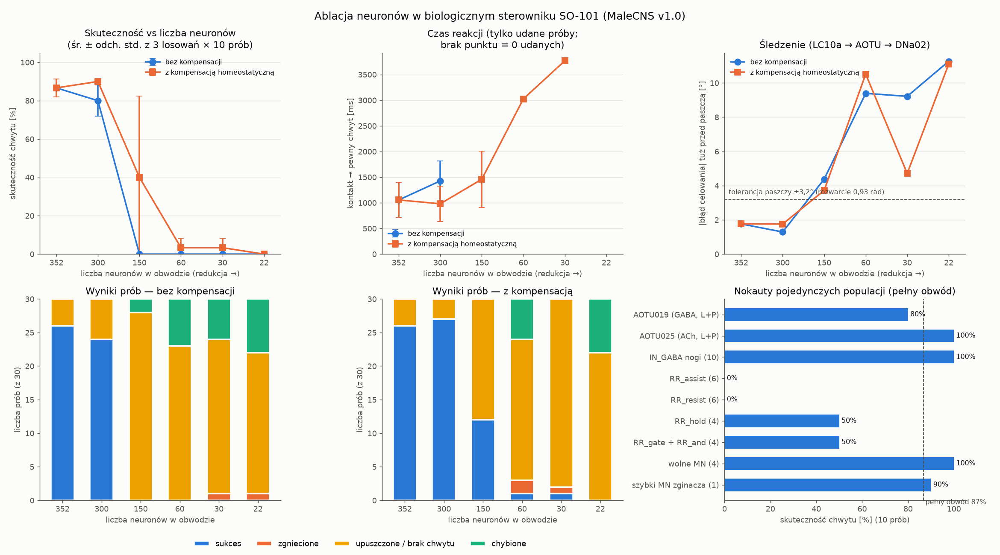

# Biologiczny sterownik SO-101 z konektomu muchy — wyniki

Projekt na Explory: ramię SO-101 (5 stawów + chwytak, serwa STS3215) sterowane impulsową siecią
neuronową (ALIF, dt = 1 ms), w której **332 neurony i 53 766 synaps pochodzą z prawdziwego konektomu
samca muchy MaleCNS v1.0**. Robot śledzi toczącą się kulkę obwodem pościgu samca
(LC10a → AOTU019/AOTU025 → DNa02) i łapie ją odruchem nogi (czucie nacisku → interneurony →
motoneurony zginacza, prostownika i ltm), nie zgniatając jej.

Wszystkie liczby poniżej pochodzą z symulacji MuJoCo. Nic nie było sprawdzane na prawdziwym ramieniu.



## Architektura

```
kamera (azymut kulki z osi bazy) ──► LC10a L/R (135+140) ──► AOTU019 (GABA, krzyżowo) ─┐
                                                        └─► AOTU025 (ACh, ta sama str.) ┴► DNa02 L/R ──► ω bazy
czujniki dotyku szczęk/dłoni ──► 20 aferentów proprioceptywnych nogi T1-L ──► 20 interneuronów ──► MN
          (campaniform sensilla)        │                                    (10 GABA, 8 ACh, 2 Glu)
                                        └──► moduł odruchu (20 neuronów MODELOWYCH):
                                             RR_assist (zatrzask „łap”) ──► zginacz + ltm (wszystkie MN)
                                             RR_gate ×2 (po jednej na szczękę) ──► RR_and (AND) ──► RR_hold (zatrzask „trzymam”)
                                             RR_resist (GABA) ──► wyłącza szybkie/pośrednie MN, słabo wolne; hamuje DNa02
MN: Ti flexor ×5 (szybki/2×pośredni/2×wolny wg rozmiaru), ltm ×4, Ti extensor ×2 (FETi/SETi) ──► mięsień ──► PWM serwa chwytaka
```

Wagi: `W = sign(nt) · J0 · ln(1 + N_syn)` (ACh +, GABA −, Glu −), membrana z modelu Shiu i in. 2024
(V_rest = −52, V_th = −45 mV, τ_m = 20 ms, τ_syn = 5 ms, refrakcja 2,2 ms, opóźnienie 2 ms),
adaptacja τ_a = 300 ms, 0,5 mV na spike.

## Dane: MaleCNS v1.0

Publiczny bucket Janelii, bez tokenu, licencja CC-BY 4.0: 211 577 ciał, 151,9 mln połączeń,
311,8 mln synaps (`sim/extract_connectome.py`). Co wyciąłem:

| obwód | neurony | z danych |
|---|---|---|
| pościg | LC10a 135 L / 140 R, AOTU019 1+1 (GABA, 0,83), AOTU025 1+1 (ACh, 0,93), DNa02 1+1 (ACh, 0,95) | LC10a_R→AOTU019_R 7595 syn., AOTU019_R→DNa02_L 297, AOTU025_L→DNa02_L 205 |
| noga T1-L | 20 aferentów (2 opisane jako CS + 18 „leg” bez podtypu), 20 interneuronów o najsilniejszej ścieżce czucie→IN→MN, 11 MN | IN_GABA→Ti extensor 1290 syn., IN_GABA→Ti flexor 405 |

Push-pull z pracy Collie i in. (Wilson lab) potwierdza się u samca: GABAergiczny AOTU019 hamuje DNa02 po
przeciwnej stronie, a cholinergiczny AOTU025 pobudza DNa02 po tej samej. Pełny raport z
literaturą i tabelą liczb: [reports/Konektom muchy dla SO101.md](reports/Konektom%20muchy%20dla%20SO101.md).

## Etap 1 — scena MuJoCo (`sim/stage1_verify.py`)

Oficjalny model SO-101 (onshape-to-robot, kinematyka i serwa producenta). Zmiany: kolizje szczęk
jako pudełka, bo otoczka wypukła meshu wypełniała paszczę; czujniki touch na wewnętrznych padach
i dłoni; chwytak w trybie PWM (3,35 N·m · u); równia i miękka kulka 5 cm / 50 g. Tarcie wg materiałów
(od wersji 3): gumowe pady szczęk μ 1,2, dłoń z PLA μ 0,35, kulka 0,3, stół i równia 0,8 — MuJoCo bierze
maksimum pary.

- 10 s, 1000 cykli × 10 kroków po 1 ms. Cykl trwa średnio 0,15 ms (p99 0,27 ms), ~37× szybciej niż czas rzeczywisty.
- Kontakty kulki: równia, stół, obie szczęki, dłoń. Brak kolizji ramię–stół. Wszystkie 6 sprawdzeń OK.
- Skryptowy chwyt: domknięcie PWM 0,25, po dotyku obu szczęk trzymanie PWM 0,05 (końcowo 1,1 N).
- Obserwacja: stały PWM 0,25–0,35 daje 10–17 N i wyciska miękką kulkę ze szczęk ustawionych w „V”, a pełny PWM — 72 N.

## Etap 2 — sieć bez fizyki (`sim/stage2_test.py`, raster: `results/stage2_raster.png`)

352 neurony (332 MaleCNS + 20 modelowych). Wszystkie 8 sprawdzeń OK:

- Brak eksplozji: maksimum pojedynczego neuronu 260 Hz (okno 50 ms). Po bodźcu sieć wraca do linii bazowej (0,43 vs 0,48 Hz).
- Huśtawka DNa02 zgodna ze stroną celu: L−R = +43 Hz dla celu po lewej, −30 Hz dla celu po prawej.
- Odwrócenie odruchu, ten sam nacisk szczęk 0,5 N:
  - stan pasywny: prostownik +5 Hz, moment −0,02 N·m (szczęka nie zamyka);
  - stan aktywny: zginacz +85 Hz, moment +1,19 N·m.

  Kryterium zmieniłem w wersji 3. W stanie pasywnym zginacze są wyciszone już przed dotykiem (0 Hz), więc „hamowanie zginacza” z wersji 1 (wtedy −0,7 Hz) jest niemierzalne. Sprawdzam zamiast tego znak momentu i odpowiedź prostownika.
- Zasada wielkości:
  - rekrutacja przy rampie prądu: wolny 61 ms → pośredni 562 ms → szybki 1138 ms;
  - derekrutacja przy rosnącej sile: szybki gaśnie po 37 ms, pośredni po 176 ms, wolny po 1998 ms.

## Etap 3 — pętla zamknięta (`sim/stage3.py`)

Sukces liczę z sił kontaktu MuJoCo, nie z czujników sterownika: kulka uniesiona ≥ 3 cm, trzymana
obiema szczękami na końcu próby, a siła ściskania (średnia 20 ms) nigdy nie przekroczyła 5 N.
Stałe strojone na ziarnach 100–119, walidowane na 120–139, testowane jednorazowo na 0–9.

Wersja 4 (obecna). Każde ziarno próby × 3 ziarna szumu sieci:

| zbiór | sukces | zgniecione | bez chwytu | chybione |
|---|---|---|---|---|
| **test (ziarna 0–9), 1 ziarno szumu** | **8/10 = 80%** | 0 | 2 | 0 |
| **test 0–9 × 3 ziarna szumu** | **26/30 = 87%** | **0** | 4 | 0 |
| walidacja 120–139 × 3 | 53/60 = 88% | 0 | 7 | 0 |
| strojenie 100–119 × 3 | 57/60 = 95% | 0 | 3 | 0 |

- Czas od kontaktu do pewnego chwytu (obie szczęki ≥ 0,3 N przez 50 ms) w próbach udanych: **981 ± 268 ms** (test 0–9).
- Latencja neuronalna (kontakt → moment > 0,2 N·m): **43 ± 6 ms**. Szczęka rusza po 107 ± 38 ms.
- Resztę czasu zajmuje domykanie z hamowaniem: armatura serwa 0,028 kg·m² z modelu producenta to ~7,8 kg masy efektywnej na końcu szczęki, więc szybkie domknięcie zgniata kulkę uderzeniem. Szczęka zamyka się więc szybko poza strefą domknięcia i hamuje dopiero w niej.
- Siła trzymania 2,4–3,1 N, szczyty 2,8–3,6 N (w v3 do 4,7 N — udział miała baza dociskająca stałą szczękę).
- Śledzenie: błąd celowania tuż przed paszczą 1,8° (tolerancja paszczy ±3,2° przy rozwarciu 0,93 rad). Bez sterowania bazą byłoby 5,7°.

### Historia wersji

| | v1 | v2 | v3 | **v4** |
|---|---|---|---|---|
| test 0–9 | 7/10, 0 zgn. | 8/10, 0 zgn. | 8/10, 0 zgn. | **8/10, 0 zgn.** |
| test 0–9 × 3 szumy | 21/30, 3 zgn. | 24/30, 3 zgn. | 24/30, 0 zgn., 6 bez chwytu | **26/30, 0 zgn., 4 bez chwytu** |
| walidacja 120–139 × 3 | — | 45/60, 5 zgn., 10 bez chwytu | 52/60, 0 zgn., 8 bez chwytu | **53/60, 0 zgn., 7 bez chwytu** |
| strojenie 100–119 × 3 | — | 54/60, 4 zgn., 2 bez chwytu | 52/60, 1 zgn., 7 bez chwytu | **57/60, 0 zgn., 3 bez chwytu** |
| kontakt → pewny chwyt | 2119 ± 241 ms | 1127 ± 375 ms | 997 ± 289 ms | **981 ± 268 ms** |

**v2 (przyspieszenie).** Tłumienie prędkością działało w całym zakresie ruchu (szczęka ~0,3 rad/s), więc kulka zdążała się wytoczyć. Zmiany:
- aferenty położenia szczęki (odpowiednik „claw” FeCO) bramkują tłumienie — silne dopiero w strefie domknięcia. **Założenie modelowe:** rozmiar kulki jest znany, więc i kąt kontaktu;
- rozwarcie startowe 1,2 → 1,0 rad.

**v3 (zakleszczenie i zgniecenia).** Diagnoza na zbiorze strojenia (ziarna 100–119 × 3) wykazała trzy mechanizmy:
1. *Klin przy dłoni.* Kulka wjeżdża głęboko i dotyka ruchomej szczęki tuż przy jej osi: ramię dźwigni ~3 cm, więc sam wolny MN daje ponad 4 N. Kulka nie mogła się wysunąć, bo wszystkie jej kontakty miały μ = 1,0 (`priority=1` kulki nadpisywało tarcie padów i dłoni). **Poprawka:** tarcie wg materiałów (dłoń PLA 0,35, pady 1,2). Bez innych zmian zgnieceń było 6 → 1 na 60 prób.
2. *Stan „trzymam” nie był bramką AND i gasł.* Jedna grupa RR_hold sumowała liniowo obie szczęki z ujemnym prądem stanu. Skutki:
   - 1,6 N na samej ruchomej szczęce włączało tryb trzymania przed ściśnięciem kulki;
   - ten sam ujemny prąd odbierał zatrzaskowi stabilny stan włączony — po 20 ms bez dotyku gasł i wracało uderzenie.

   **Poprawka:** RR_gate (po 1 neuronie na szczękę, bez adaptacji, rezystancja ×8, więc nasycają się już przy lekkim dotyku) → RR_and (prąd −18,8 mV) → RR_hold ze zwykłym prądem. Zmierzone: 5 N na jednej szczęce nie włącza; 0,5 N na obu włącza; po puszczeniu zatrzask trzyma (~70 Hz).
3. *Ogranicznik siły reagował na samo pchanie.* Pchanie swobodnej kulki jej nie zgniata; zgniata ściśnięcie z dwóch stron. Bezpośrednia ścieżka „ruchoma szczęka → RR_resist” jest teraz słabsza (300 synaps zamiast 1000), a mocne cięcie robi AND → RR_hold → RR_resist.

Stałe dobrane przeszukiwaniem 80 konfiguracji × 60 prób na zbiorze strojenia (wynik = sukcesy − 2·zgniecenia). Z trzech najlepszych wybrałem tę z najlepszą walidacją. Test 0–9 uruchomiony raz.

Sprawdzone i odrzucone w v3:
- wygasanie celu serwa bazy (τ = 30–300 ms) — mechanizm dociskania był prawdziwy (−2 N·m przy ω ≈ 0), ale na 60 próbach nie poprawił wyniku (85% i 5 zgn. wobec 90% i 4), więc go cofnąłem;
- dodatkowy prąd „stanu pasywnego” dla RR_resist — nie zmieniał wyjścia, cofnięty.

**v4 (próby bez chwytu).** Klasyfikacja porażek v3 (`sim/classify.py`): z 7 prób bez chwytu na zbiorze strojenia 6 to wytoczenia, 1 to przepychanie. Przy wytoczeniu kulka przyjeżdża ~5° obok środka (po stronie ruchomej szczęki), uderza w jej wewnętrzną ścianę i jest wypychana na zewnątrz przez domykającą się szczękę ustawioną w „V”.

Błąd celowania był w większości *deterministyczny*, nie szumowy:
- korelacja z początkowym przesunięciem kulki: 0,71, z jej prędkością boczną: 0,53;
- rozrzut między ziarnami 2,3°, a szum sieci tylko 1,2°.

Robot nie nadążał za kulką, której azymut szybko rośnie, gdy toczy się w stronę bazy. Zmiany:
1. Wzmocnienie pościgu k_yaw 0,04 → 0,08, tj. ~5,4 (°/s)/° — powyżej zakresu zmierzonego u muchy (2–3,3). Na 60 próbach strojenia: bez chwytu 7 → 1, ale zgnieceń 1 → 6. Zgniecenia miały siłę tylko na stałej szczęce, 0,2–0,3 s po kontakcie: rozpędzona baza wbijała w kulkę stałą szczękę.
2. Zatrzymanie bazy przy dotyku (`CONTACT_STOP` w `stage3.py`): przy dowolnym nacisku czujników chwytaka cel serwa bazy = bieżąca pozycja. To reguła warstwy serwa, nie neuron. Ten sam pomysł w sieci (RR_stop: 2 neurony GABA, dotyk → hamowanie DNa02) **pogorszył** wynik (44/60, 12 zgnieceń): komenda skrętu gasła, ale zostawało przesunięcie celu serwa i baza pchała dalej z −1 N·m.

Sprawdzone i odrzucone w v4 (60 prób strojenia; v3 = 52/60, 1 zgn., 7 bez chwytu):

| zmiana | sukces | zgn. | bez chwytu |
|---|---|---|---|
| chwyt wyzwalany z widzenia (kulka < 6 / 8 / 10 cm od punktu chwytu) | 52 / 48 / 44 | 2 / 1 / 0 | 6 / 11 / 16 |
| punkt celowania 1–2,4 cm w stronę stałej szczęki | 44 / 42 / 35 | 3 / 6 / 6 | 13 / 12 / 19 |
| punkt celowania 0,6–1,3 cm w stronę ruchomej szczęki | 47 / 40 | 2 / 1 | 11 / 19 |
| RR_stop w sieci (k_yaw 0,08), też z wygasaniem celu serwa τ 0,05/0,1 s | 44 / 45 / 48 | 12 / 7 / 6 | 4 / 8 / 6 |
| przeszukiwanie 79 losowych konfiguracji (k_yaw, siła, tłumienie, bramka) | najlepsza 49 | 3 | 8 |
| słabszy opór z ruchomej szczęki (syn_jaw_resist 30 / 60 / 100 zamiast 300) | 4 / 55 / 58 | 54 / 3 / 0 | 2 / 2 / 2 |

Opór z ruchomej szczęki zostaje na 300. 100 dawało na strojeniu 58/60, ale na walidacji 52/60 (300: 53/60), a przy 60 zaczyna się urwisko zgnieceń.

Wybór k_yaw: 0,06 / 0,07 / 0,08 / 0,10 z zatrzymaniem bazy dały na strojeniu 54 / 52 / 57 / 50 sukcesów, wszystkie bez zgnieceń. Na walidacji 0,06 → 47/60, 0,08 → 53/60.

Co zostało:
- na walidacji poprawa wobec v3 mieści się w szumie (+1 próba); wyraźna jest na strojeniu (+5) i teście (+2);
- 4 porażki testu: 2 wytoczenia, 1 przepychanie (ruchoma szczęka 4,3 s naciska, stała nie), 1 inna.

## Etap 4 — ablacja neuronów (`sim/stage4_ablation.py`)

Z każdej z 22 populacji usuwam losowo ten sam odsetek neuronów, ale zostawiam ≥ 1 w każdej (22 neurony to
minimum strukturalne: po 1 na populację). Dla każdej wielkości: 3 losowania × 10 prób. Warianty:

- bez kompensacji;
- z kompensacją homeostatyczną — ocalałe neurony przejmują synapsy usuniętych z populacji (wagi × n_pełne/n_zostało), a ocalałe MN przejmują ich włókna mięśniowe.

| neurony | sukces bez komp. | sukces z komp. | zgniecione (bez / z, z 30) | błąd celowania (bez / z) | reakcja [ms] (bez / z) | CPU [ms/cykl 10 ms] |
|---|---|---|---|---|---|---|
| 352 | 87 ± 5% | 87 ± 5% | 0 / 0 | 1,8° / 1,8° | 1056 / 1056 | 0,42 |
| 300 | 80 ± 8% | **90 ± 0%** | 0 / 0 | 1,3° / 1,8° | 1427 / 981 | 0,43 |
| 150 | 0% | 40 ± 42% | 0 / 0 | 4,4° / 3,7° | — / 1459 | 0,32 |
| 60 | 0% | 3 ± 5% | 0 / 2 | 9,4° / 10,5° | — / 3025 | 0,25 |
| 30 | 0% | 3 ± 5% | 1 / 1 | 9,2° / 4,7° | — / 3769 | 0,25 |
| 22 | 0% | 0% | 1 / 0 | 11,3° / 11,1° | — | 0,24 |

Nokauty pojedynczych populacji w pełnym obwodzie (10 prób, ziarno szumu 0; pełny obwód w tych samych próbach: 8/10):

| usunięte | sukces | co się dzieje |
|---|---|---|
| RR_resist (6) | 0% | 7/10 zgniecionych, szczyt 27 N — bez hamowania nie ma regulacji siły |
| RR_assist (6) | 0% | 10/10 bez chwytu — nie ma zatrzasku „łap” |
| RR_hold (4) | 50% | 5 zgniecionych — bez stanu „trzymam” szybkie MN wracają po domknięciu |
| RR_gate + RR_and (4) | 50% | 5 zgniecionych — to samo, bo bez bramki zatrzask się nie włącza |
| AOTU019 L+P | 80% | |
| szybki MN zginacza (1) | 90% | |
| AOTU025 L+P | 100% | 10 prób to za mało, by odróżnić 80–100% |
| IN_GABA nogi (10) | 100% | jw. |
| wolne MN (4) | 100% | jw. |

Kontrola mechanizmu (`--protected`): ablacja jak wyżej, ale moduł odruchu (20 neuronów) zostaje w całości.

| neurony | sukces bez komp. | sukces z komp. |
|---|---|---|
| ~162 | 23% (8 zgniecionych) | 67% |
| ~75 | 0% | 13% |
| ~45 | 0% | 13% |

### Wnioski

1. **Przy 300 neuronach straty wynikają z utraty łącznego pobudzenia, nie z liczby komórek.** Bez kompensacji 80 ± 8%, z kompensacją 90 ± 0% — tyle co pełny obwód (87 ± 5%).
2. **Poniżej ~150 neuronów kompensacja przestaje wystarczać** (40% przy 150, ≤ 3% od 60 w dół). Przyczyny:
   - zatrzaski z 1 neuronem nie samopodtrzymują się (brak autapsy). Ochrona modułu odruchu podnosi wynik przy ~160 neuronach z 40% do 67% (z kompensacją), ale niżej nie ratuje;
   - z 275 LC10a zostaje 6–12 i śledzenie traci precyzję (błąd 4–11° wobec tolerancji 3,2°). W v4 to główna przyczyna: od 60 neuronów w dół pojawiają się chybienia (6–8 na 30);
   - z puli 5 zginaczy zostaje 1. Jeśli to szybki MN, nie ma wolnych jednostek do delikatnego trzymania.
3. **Najważniejsze dla „nie zgnieść” są neurony hamujące (RR_resist) i stan „trzymam” z bramką AND.** Bez nich zgnieceń jest 5–7 na 10.
4. **Koszt CPU prawie nie zależy od liczby neuronów:** 352 → 22 skraca cykl tylko 1,8× (0,42 → 0,24 ms). Dominuje narzut Pythona na krok, nie mnożenie macierzy N×N. Pełny obwód zużywa ~4% budżetu 10 ms.

## Co jest z konektomu, a co nasze (ważne na konkurs)

- **Z danych:** tożsamość i liczba neuronów, wszystkie liczby synaps między nimi, neuroprzekaźniki (znak), rozmiar MN (synapsy wejściowe), który wyznacza klasę szybki/pośredni/wolny.
- **Z literatury:**
  - parametry membrany (Shiu 2024);
  - stosunki rezystancji i siły klas MN (Azevedo 2020);
  - pola LC10a −15°…165° (Ribeiro 2018);
  - wzmocnienie pościgu u muchy ~2–3,3 (°/s)/° (Collie 2025) — robot w v4 ma ~5,4, bo przy wartościach muszych nie nadążał za kulką.
- **Nasze (model, strojone w symulacji):**
  - 20 neuronów modułu odruchu i ich połączenia (w tym bramka AND: RR_gate z rezystancją ×8);
  - prądy tła (zastępują niezmodelowane wejścia, np. DNa02 ma silniejsze wejście z AN03A008 niż z AOTU);
  - wzmocnienia wejścia LC10a 0,5 i DNa02 2,5;
  - przydział aferentów do czujników;
  - mięsień → moment (k_muscle);
  - tłumienie prędkością szczęki (odpowiednik aferentów prędkości FeCO), bramkowane kątem szczęki — strefa domknięcia q < 0,97 rad przyjęta przy założeniu, że rozmiar kulki jest znany;
  - auto-trym DNa02, który kompensuje asymetrię L/P konektomu, inaczej dającą stały przechył ~7°;
  - zatrzymanie bazy przy dotyku chwytaka (reguła warstwy serwa, nie neuron — wersja w sieci nie działała, patrz v4).
- **Odchylenie od standardu:** wagi ln(1+N) zamiast liniowych jak u Shiu (o to prosiło zadanie). Logarytm ściska jedną silną synapsę AOTU→DNa02 i trzeba ją było kompensować wzmocnieniem DNa02.
- **Uproszczenia fizyki:**
  - tarcie wg materiałów (wartości przyjęte, nie zmierzone na prawdziwym chwytaku). Do v2 wszystkie kontakty kulki miały μ = 1,0, co powodowało klin przy dłoni;
  - „oko” siedzi na osi bazy (kamera nieruchoma), nie na chwytaku. Oko na chwytaku dawało oscylacje ±40°;
  - przed puszczeniem kulki robot 1 s patrzy na nią i obraca się w jej stronę.
- **Słabe strony:**
  - 5–13% prób kończy się bez chwytu (kulka wytacza się przed domknięciem albo jest długo przepychana); zgnieceń 0 we wszystkich 150 próbach testu, walidacji i strojenia;
  - siła trzymania 2,4–3,1 N, szczyty do 3,6 N;
  - reakcja ~1 s jest daleka od muchy; ogranicza ją inercja serwa, nie sieć (latencja 43 ms);
  - odwrócenie odruchu zrobiłem jako bramkowanie stanem aktywny/pasywny. W stanie pasywnym widać je tylko jako +5 Hz na prostowniku, bo zginacze są wtedy wyciszone.

## Jak uruchomić

```bash
uv venv -p 3.12 .venv && uv pip install -p .venv/bin/python mujoco numpy matplotlib scipy pandas pyarrow
cd sim
../.venv/bin/python stage1_verify.py          # Etap 1
../.venv/bin/python stage2_test.py            # Etap 2 → results/stage2_raster.png
../.venv/bin/python stage3.py 10              # Etap 3, ziarna 0–9
../.venv/bin/python stage4_ablation.py        # Etap 4 → ablation_results.png, results/ablation.json (~35 s, 8 rdzeni)
../.venv/bin/python stage4_ablation.py --protected
../.venv/bin/python evaluate.py '{}' 120 140 --noise-draws 3   # dowolne parametry na zakresie ziaren
../.venv/bin/python tune.py 80 ../results/tune.json          # przeszukiwanie na ziarnach strojenia (~10 min)
../.venv/bin/python tracecase.py 106 1                       # przebieg próby wokół szczytu siły
../.venv/bin/python trial_plot.py 4 ../results/stage3_trial4.png      # przebieg jednej próby
../.venv/bin/python render_trial.py 4 0.3,0.7,1.5,2.6 ../results/x.png # klatki z próby
```

Ekstrakcję z MaleCNS (`extract_connectome.py`) trzeba uruchomić tylko po zmianie wyboru neuronów.
Wymaga pobrania ~1,1 GB do `data/malecns/` (adresy są w nagłówku skryptu). Wynik jest w repo jako `sim/circuit_malecns.json`.
