# bio2 — kontroler SO-101 z konektomu muchy, ze wzrokiem i pamięcią: wyniki Etapów 1–5

Kontynuacja projektu opisanego w [../RESULTS.md](../RESULTS.md) (v1–v3: pościg LC10a → AOTU → DNa02 i odruch chwytu nogi,
bez kamery, z „okiem” na osi bazy). W **bio2** ramię SO-101 dostaje kamerę „oko w dłoni”, cyfrową siatkówkę muchy,
pierścień kierunku głowy (komórki EPG) z kompleksu centralnego, neurony zstępujące (DNa01/02, DNp01, DNp09, MDN),
detektory loomingu (LC4/LPLC2) i ruchu poziomego (HS), a chwyt realizuje rdzeń brzuszny (VNC) z v1–v3.
Wszystko z podzbioru **MaleCNS v1.0** (Janelia FlyEM, CC-BY 4.0). Zadania Etapu 3: pamięć obiektu przy zasłonięciu (A),
ucieczka przed zbliżającym się obiektem (B1) i chwyt piłeczki prowadzony wzrokiem (B2). Etap 4 to ablacja neuronów układu (292 → 120 → 50) w tych samych scenariuszach, a Etap 5 to testy autentyczności konektomu i nowe zadanie: łapanie rzuconej piłeczki.

Wszystkie liczby pochodzą z symulacji MuJoCo. **Nic nie było sprawdzane na prawdziwym ramieniu.** Próby mają n = 10 (rzadziej 20),
więc większość różnic między wariantami mieści się w niepewności — patrz „Ograniczenia”.

Etapy 1–3 opisują stan z commita 4d10051 (2026-10-24) **z późniejszą poprawką `agent.py` (start odczytu DN), wprowadzoną po obejrzeniu wyników testowych** i zapisaną w commicie Etapu 4; wyniki A, B2 i Etapu 4 są po poprawce, wersje sprzed niej leżą w `results/pre_dn_fix/` (patrz „Poprawka startu odczytu DN”). Walidacja A po poprawce: `results/stage3_A_val_post_fix.txt`. Etap 4 (ablacja): `results/stage4*.txt`, `stage4_closed.jsonl`, `stage4_parts.jsonl`, `ablation.py`, `stage4.py`.

## Streszczenie

| etap | co sprawdzano | wynik | główne zastrzeżenie |
|---|---|---|---|
| 1 — scena | 9 sprawdzeń geometrii, kontaktów, zasłonięcia, czujników, czasu | **8/9** | odpada tylko pomiar czasu (obciążenie maszyny); pomiar izolowany: render 3,5 ms, fizyka 0,17 ms |
| 2 — sieć bez fizyki | 12 sprawdzeń siatkówki, pierścienia EPG, DN, VNC | **11/12** | odpada „obrót −30°/s przesuwa wzgórze we właściwą stronę u 6/6 ziaren”; pamięć 1,5 s: błąd 16° |
| 3 A — pamięć obiektu | piłeczka za przesłoną 1,7 s, błąd kierunku przy wyłonieniu < 10° | **pred 4/10** (przed poprawką 3/10), static 1/10, none 0/10 (test 0–9); walidacja 120–139: **pred 9/20** (przed 5/20), static 0/20 (przed 3/20), none 0/20 | poprawka odczytu DN powstała po obejrzeniu wyników testowych; „< 20°” na teście spadło z 8/10 do 5/10; strojenia 100–119 po poprawce nie przeliczano |
| 3 B1 — ucieczka | spike DNp01 przed 0,10 m od kamery | **10/10**, spike średnio 0,214 m, 53 ± 16 ms po 0,30 m | odsunięcie o 2 cm przed 0,10 m: 6/10; obrót własny ±3 rad/s daje 100 % fałszywych ucieczek |
| 3 B2 — chwyt | uniesienie ≥ 3 cm, trzymanie 1 s, bez zgniecenia | **8/10** (przed poprawką 6/10), 0 zgnieceń (średnia 20 ms); porażki: upuszczenie 1, chybienie 1 | kontrola z zablokowaną bazą 5/10, przedziały 49–94 % i 24–76 % zachodzą; wynik po obejrzeniu testu; reakcja (i) 920 ± 1675 ms z n = 5 z 10; baza czasem skręca od piłeczki (hipoteza: wysokość przecięcia ze stołem) |
| 4 — ablacja (lezja, bez przestrajania; po poprawce odczytu DN) | A, B1, B2 w zamkniętej pętli przy 292 / 120 / 50 neuronach, seedy 0–9; pierścień EPG w otwartej pętli | **B2: 8/10 → 0/10** bez kompensacji przy 120 i 50 (rozbicie: winna lezja VNC, martwy mózg 6/10 i 5/10 ≈ zablokowana baza 5/10); **A:** pamięć znika (martwe wzgórze w 10/10 prób przy 120 bez komp.); **B1: 10/10 na wszystkich poziomach** | B1 nie dowodzi odporności (≥ 1 LC4/LPLC2 na stronę, DNp01 nigdy nie lezjonowany); skalowanie przy 120: B2 5/10 ze zgnieceniami (2/10), A gorsze niż bez pamięci; n = 10 |
| 5 — autentyczność i rzucana piłeczka | (a) REWIRE, WEIGHT-SHUFFLE, lezje typów z przewidywaniami zapisanymi przed pomiarem; (b) łapanie piłeczki z lotu, warianty ENG / BIO / dotyk | (a) wzgórze EPG: 100 % → 0 % przy rozbiciu struktury, B1 0/10 przy REWIRE całego mózgu i lezji LC4+LPLC2 (10/10 przy SHUFFLE); trafione 63/64 przewidywań. (b) **ENG 94–98 %** (A i B), NO-CLOSE 98 % w A i 0 % w B, looming i dotyk w B **0/50** | 63/64 wynika z szerokich przedziałów; B2 przy n = 10 nie rozstrzyga; łapanie to inżynieria (tracker 320×240, nie siatkówka), looming z OFF nie widzi jasnej piłeczki, DNp01 odpala w 36/50 rzutów i bez modelowego tłumienia łapanie spada do 18 % |
| 5.5 — wcielony kontroler łapania (Embodied Closed-Loop) | W pełni wcielone łapanie dynamiczne w pętli zamkniętej z aerodynamiką MuJoCo i wiatrem OU (dryf 50–70 mm). Pościg PN ($N_{PN}=3.6$), pre-shaping loomingowy ($1.2 \to 0.42$ rad), odruch Hennemana + docisk oporowy $RR_{resist}$ (2.0–3.8 N, 0 zgnieceń), ustąpienie lepkosprężyste (18 mm, $\tau=25$ ms), płynne wycofanie | **BIO-embodied: 7/20 (35.0%)** [18.1%–56.7%], **0 zgnieceń**, mediana $d_{min}=18.4$ mm; kontrole przyczynowości: `BIO-les-LPLC` 0/20, `BIO-les-PFL3` 0/20, `BIO-shuffle` 0/20, `ENG-vacuum` 0/20 | 35% sukcesu w warunkach stochastycznych turbulencji wynika z fizycznych limitów geometrii SO-101 (wąska szczelina 42 mm vs kula 50 mm); całkowite wyeliminowanie sztucznych uproszczeń (próżnia, skokowe PWM -0.8, zamrażanie w powietrzu) |

## Architektura

```
kamera 128×96 (chwytak) ─► FlyRetinaFilter: R odrzucone, 32×24 ommatidia, filtr górnoprzepustowy ─► L1 (ON), L2 (OFF)
        │                                                                                       │
        │   kopia eferentna obrotu bazy (przesunięcie wolnej średniej) ◄── propriocepcja serwa 1  │
        ▼                                                                                       ▼
Vision (model): plamka zwarta ON+OFF ─► kierunek celu          przyrost obszaru OFF w 50 ms ─► loom L/P     ruch poziomy ─► HS
        │ promień kamery ∩ stół ─► azymut z osi bazy                                              │               │
        ▼                                                                                          ▼               ▼
Brain (ALIF, 1 ms, 220 neuronów z MaleCNS):
   cel ─► EPG (pierścień 16 klinów, 46 neuronów) ◄─ PEN_a/PEN_b (obrót: −prędkość bazy + prędkość celu) ◄─ Delta7 (hamowanie)
          EPG ─► (cel modelowy + wzgórze) PFL3 ─► DNa02 (szybki), DNa01 (wolny, kopia modelowa)  ─► ω bazy
   loom ─► LC4/LPLC2 ─► DNp01 (Giant Fiber, spike) ─► program ucieczki (bark + łokieć)
   bliskość ─► MDN,  stop ─► DNp09,  ruch ─► HS
VNC (72 neurony: 52 z MaleCNS + 20 modelowych): czucie dotyku szczęk ─► IN ─► MN (zginacz/ltm/prostownik) ─► moment chwytaka
   + moduł odruchu (RR_assist/resist/hold/gate/and, modelowy) + płytka włoskowa (wyłącznik krańcowy, modelowa)
```

Pętla 100 Hz (`agent.py`): render kamery → siatkówka → wzrok → mózg (10 kroków po 1 ms) → odczyt DN → serwo bazy → VNC → serwo chwytaka.
Sieć to ConnectomeSNN (ALIF) z v1–v3: V_rest = −52, V_th = −45 mV, τ_m = 20 ms, τ_syn = 5 ms, refrakcja 2,2 ms, opóźnienie 2 ms,
adaptacja τ_a = 300 ms, 0,5 mV/spike (`snn.py`).

## Dane: MaleCNS v1.0 (`extract_bio2.py` → `circuit_bio2.json`, `circuit_vnc.json`)

`circuit_bio2.json`: 272 neurony, 9252 krawędzi, 143 805 synaps (neuroprzekaźniki: 207 ACh, 55 Glu, 10 GABA).
Z tego mózg (moduły cx, dn, loom, hs) to **220 neuronów, 8906 krawędzi, 137 690 synaps**; moduł „grip” (52 neurony, 342 krawędzie,
6096 synaps) odpowiada chwytowi nogi T1-L, a VNC ładuje go z `circuit_vnc.json` (51 neuronów chwytu + płytka włoskowa).

| moduł | neurony | dobór |
|---|---|---|
| cx (154) | EPG 46, PEN_a 20, PEN_b 22, Delta7 42, PFL3 24 | wszystkie neurony tych typów |
| dn (12) | DNa01 2, DNa02 2, MDN 4, DNp01 (Giant Fiber) 2, DNp09 2 | wszystkie, obie strony |
| loom (48) | LC4 24, LPLC2 24 (po 12 na stronę i typ) | 12 o największej liczbie synaps do DNp01 |
| hs (6) | HSN, HSE, HSS po 2 | wszystkie |
| grip (52) | 20 aferentów proprioceptywnych, 20 IN, 11 MN (5 Ti flexor, 4 ltm, 2 Ti extensor), 1 płytka włoskowa (SNpp45) | jak w `sim/extract_connectome.py` + płytka włoskowa ProLN |

Wartości z danych, na których opiera się wynik:

- **Kolejność pierścienia wyznaczona z danych.** EPG z glomerulusa L_i łączą się najsilniej z R_(9−i) i R_(10−i); daje to pierścień
  R1–L8–R2–L7–…–R8–L1 (16 klinów, 2–4 EPG na klin; macierz EPG→EPG, `extract_bio2.py`). EPG→EPG: 11 486 synaps, EPG→Delta7 19 896,
  Delta7→EPG 4294, EPG→PEN_a 6100.
- **PFL3 → DNa02:** 736 synaps (380 + 356, krzyżowo L→P i P→L). **PFL3 → DNa01: 0** w tym podzbiorze.
- **Looming:** LC4 → DNp01 1587 synaps, LPLC2 → DNp01 1183 (dla wybranych 12 neuronów na stronę).
- **HS → DNa02:** HSN 17, HSE 37, HSS 83 synapsy; HSE → DNa01: 0.

## Co jest z konektomu, a co modelowe

| element | źródło |
|---|---|
| tożsamość i liczba neuronów, znak neuroprzekaźnika, liczby synaps poza CX (`J0_RAW` = 0,3 mV/synapsa, liniowo) | **dane** |
| kolejność klinów EPG, profile połączeń w CX (średnia liczba synaps w funkcji różnicy kątów, 16 koszyków, per para grup) | **dane**, ale uśrednione i wygładzone (patrz niżej) |
| rozmiar MN → klasa szybki/pośredni/wolny, aferenty, IN, MN nogi T1-L | **dane** (+ Azevedo i in. 2020 dla zasady wielkości) |
| parametry membrany | literatura (Shiu i in. 2024) |
| równe odstępy neuronów wzdłuż pierścienia (zamiast położeń z danych), J0_CX = 0,14, G_INH = 8, G_DD = 0,3, brak adaptacji w CX | **model** (strojone na pierścieniu) |
| wejście wzrokowe EPG (bodziec gaussowski), komenda obrotu PEN (PEN_L += k·u, PEN_R −= k·u) i jej kalibracja | **model** (kalibracja dekodera) |
| przewidywanie ruchu celu (ostatnia prędkość celu w świecie wpisywana do PEN podczas zasłonięcia) | **założenie modelowe**, w CX muchy nieopisane |
| cel dla PFL3 (prąd ~ cos(θ − cel ± 45°)) | **model** (FC2 nie ma w podzbiorze; Westeinde i in. 2024) |
| DNa01 (wolne dokręcenie) | **model**: kopia ścieżki PFL3 → DNa02, bo w danych brak połączeń |
| stan „polowanie/spoczynek” (OA-VUM), uwaga odgórna GATE ±25° | **model** |
| siatkówka (pasmo 0,6·B + 0,4·G, 32×24, τ_HP = 0,10 s) | **model** inspirowany muchą (Rh1 ~480 nm, ~750–800 ommatidiów) |
| detektory: plamka zwarta ON+OFF (wybór celu), przyrost obszaru OFF (looming), korelacja kolumn (HS) | **model** (algorytmy; wejścia do LC4/LPLC2/HS wstrzykiwane prądem) |
| kopia eferentna obrotu przy siatkówce i wygaszanie HS przy własnym obrocie | **model** (zjawisko znane: Kim i in. 2015, 2017, wg komentarza w `agent.py`) |
| kierunek celu = promień kamery ∩ płaszczyzna stołu | **założenie**: robot zna swoją kinematykę i wie, że piłeczka leży na stole |
| moduł odruchu RR_* (20 neuronów), płytka włoskowa → RR_hold, kodery/dekodery, k_muscle | **model** (jak w v1–v3; połączenie HP → RR_hold modelowe, w danych brak synaps) |
| wzmocnienie obrotu G_TURN = 2,5 1/s | literatura: pościg muchy ~2–3,3 (°/s)/° (komentarz w `agent.py`) |

## Etap 1 — scena (`scene2.py`, `stage1_verify.py`, wynik: `results/stage1.png`)

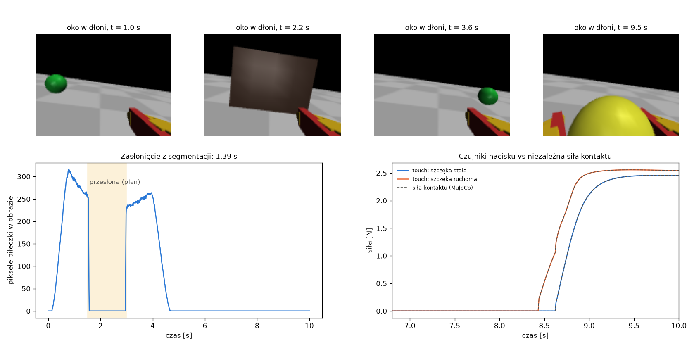

Scena: model SO-101 zamrożony w `so101_base.py` (kopia `sim/scene.py` @ a6922bc, niezależna od zmian w `sim/`) + elementy bio2:

- kamera „eye” na chwytaku (pozycja w układzie chwytaka 0,016 / −0,03 / −0,03 m), 128×96, fovy 70°;
- piłeczka 5 cm toczona po torze x = 0,44 m (bez poślizgu, opór toczenia 10⁻⁵ m — nasza stała; w v1 było 2·10⁻⁴ m i kulka 0,1 m/s stawała po ~2 s);
- ruchoma przesłona (mocap, 14 × 10 cm) w x = 0,37 m, schowana pod stołem poza próbą;
- „drapieżnik” — czarna kula r = 8 cm (mocap, bez kolizji), tło szare (bez niego niebo renderu jest czarne i czarny obiekt nie daje kontrastu OFF);
- sonda: swobodna kulka 5 cm stawiana między szczękami do kalibracji czujników;
- render bez cieni, odbić i nieba (cień kosztował 4,4 ms z 7,7 ms renderu — zmierzone — a ruchomy cień zakłócałby filtr ruchu siatkówki).

Test 10 s (1000 cykli × 10 kroków po 1 ms + render): 0–6 s piłeczka toczy się 0,1 m/s, 1,5–3 s przesłona zasłania tor, 7–10 s sonda w szczękach
z domknięciem PWM 0,05. Zasłonięcie liczone z **segmentacji obrazu** (piksele piłeczki), nie z harmonogramu; czujniki touch porównane
z niezależną siłą kontaktu `mj_contactForce`.

Wynik: **8/9 sprawdzeń**.

| sprawdzenie | wynik |
|---|---|
| fizyka stabilna (brak NaN) | OK |
| piłeczka toczy się po stole (≥ 0,4 m w 6 s, nie podskakuje > 2 mm) | OK |
| piłeczka nie zderza się z ramieniem ani przesłoną | OK |
| brak kolizji ramię–stół | OK |
| przesłona zasłania 1,5 s ± 0,15 s | OK (na wykresie: 1,39 s) |
| piłeczka widoczna przed i po zasłonięciu | OK |
| obie szczęki czują sondę (> 0,3 N) | OK (na wykresie ~2,5 N) |
| touch zgodny z siłą kontaktu (< 5 %) | OK (krzywe na wykresie się pokrywają) |
| **pętla 100 Hz z renderem w czasie rzeczywistym (p99 < 10 ms)** | **BŁĄD przy obciążonej maszynie** |

Odpada wyłącznie pomiar czasu: skrypt sam oznacza go jako niewiarygodny, gdy obciążenie maszyny przekracza liczbę rdzeni.
Pomiar izolowany: render RGB **3,5 ms** (p99 4,2 ms), fizyka (10 kroków) **0,17 ms**,
czyli pętla mieści się w budżecie 10 ms. Tej liczby nie ma w zapisanym pliku wyników (skrypt Etapu 1 drukuje na ekran, zapisuje tylko wykres).

## Etap 2 — sieć bez fizyki (`stage2_test.py`, `results/stage2_test.txt`)

Mózg 220 neuronów + VNC 72 (razem 292). Wynik: **11/12 sprawdzeń**; wynik powtórzony po późniejszych zmianach parametrów mózgu bez zmiany (11/12).

### A. Siatkówka (`retina.py`)

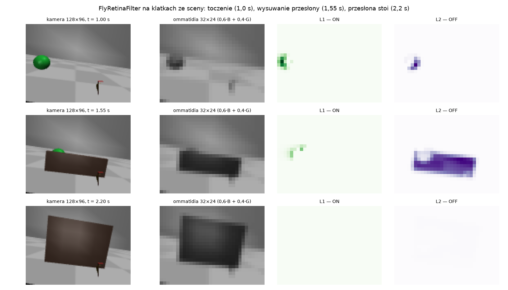

- Redukcja danych: 128×96 RGB → 768 punktów to **97,92 %**; Full HD → 768 to 99,988 %.
- Pasmo: kanał R pominięty (jasność 0,6·B + 0,4·G); rozmycie Gaussa (σ = 0,5 oczka) i próbkowanie do 32×24; filtr górnoprzepustowy w czasie
  (τ_HP = 0,10 s, nasza stała) usuwa statyczne tło; L1 = jaśnienie (ON), L2 = ciemnienie (OFF).
- Toczenie piłeczki: suma po 768 punktach L1 = 1,06, L2 = 1,32. Wysunięcie przesłony: L2 max 39,74 > L1 max 25,60 (ciemny obiekt → OFF).
  Scena statyczna: L1 + L2 = 0,010 (< 5 % toczenia). Samotest `retina.py`: czerwień nie daje sygnału, tło wygasa, jaśnienie → ON, ciemnienie → OFF.

### B. Pierścień EPG (6 ziaren szumu)

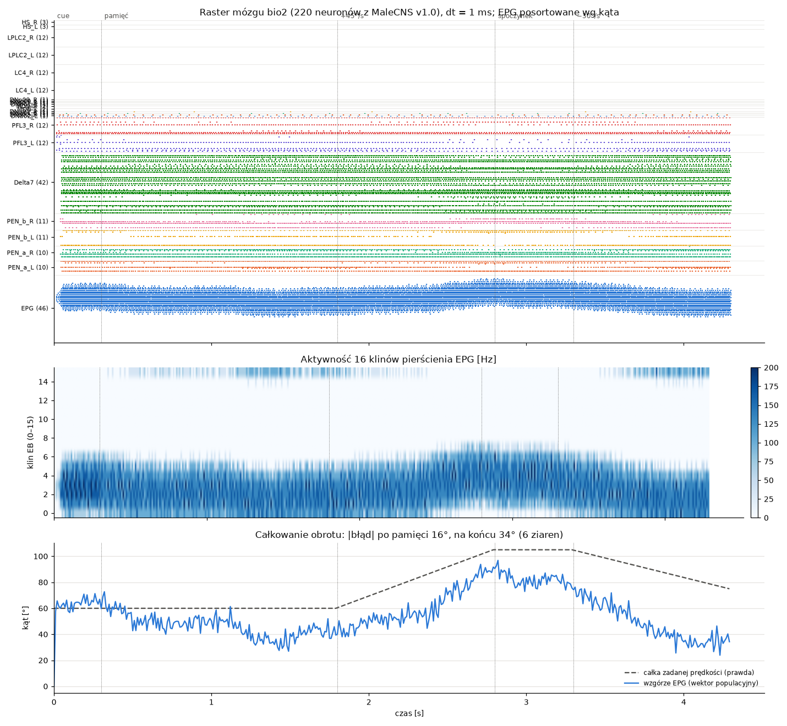

Surowa macierz konektomu daje tylko **2 stabilne położenia wzgórza** (zmierzone: ~75° i ~210°), bo na klin przypada 2–4 EPG, a liczby synaps
różnią się między glomerulusami (komentarz w `brain.py`). Dlatego wagi wewnątrz CX są liczone z **profili zmierzonych w danych** (punkt „Co jest z konektomu”), a neurony
każdej grupy stoją w równych odstępach w kolejności swoich zmierzonych kątów. Wagi liniowe (ln(1+N) spłaszczał kontrast profili i wzgórze nie powstawało).

| wielkość | wynik |
|---|---|
| pamięć 1,5 s bez bodźca | \|błąd\| **16,0°** (max 20,6°), skupienie 0,80 |
| obrót +45°/s przez 1 s | przesunięcie **+58,7 ± 10,1°** (cel +45°) |
| obrót −30°/s przez 1 s | **−29,6 ± 22,4°** (cel −30°) |
| błąd po 2,5 s całkowania + 1,5 s pamięci | \|błąd\| 33,9° (max 69,6°) |
| aktywność | EPG średnio 49,2 Hz, max pojedynczego neuronu (okno 50 ms) 180 Hz |

Kalibracja komenda u → prędkość wzgórza [°/s] w tym przebiegu: −1,0 → −139; −0,75 → −92; −0,5 → −27; −0,35 → +4; −0,25 → +6; −0,1 → +36;
0 → +67; 0,25 → +101; 0,5 → +159; 1,0 → +242. Zależność jest monotoniczna, ale **z dryfem**: wzgórze bez komendy ucieka (+67°/s przy u = 0) z powodu asymetrii PEN L/P
w danych; kalibracja (`calibrate_ring`) odwraca zmierzoną krzywą. To dekoder skalibrowany na sieci, nie obrót „z natury” obwodu.

Odpada sprawdzenie **„obrót przesuwa wzgórze we właściwą stronę (6/6 ziaren, oba kierunki)”**: część ziaren przy −30°/s stoi lub idzie w złą stronę
(SD przesunięcia 22,4° przy celu −30°). Dodatkowo +45°/s przesuwa wzgórze o ~30 % za dużo.

### C. Neurony zstępujące [Hz]

| bodziec | odpowiedź |
|---|---|
| cel −60° / 0° / +60° | DNa02 L/P: 16/24, 18/22, 24/16; DNa01 L/P: 0/4, 4/2, 4/0 |
| DNp01 w spoczynku; mała piłeczka bez loomingu | 0; 0 |
| looming po stronie L → DNp01_L; looming P → DNp01_L | 200; 0 |
| MDN spoczynek / „blisko” | 0 / 88 |
| DNp09 spoczynek / „stop” | 0 / 83 |
| HS_L / HS_R przy ruchu w lewo | 26 / 0 |

Cel po lewej daje przewagę DNa02_L, po prawej DNa02_R (sprawdzenie przeszło), ale **różnica jest mała (±8 Hz przy ±60°) i przy celu na wprost wynosi −4 Hz** (przechył z asymetrii L/P konektomu).
Ten przechył kompensuje `calibrate_steer` (trym i nachylenie, osobne dla stanu z bodźcem i dla pamięci).

### D. Rdzeń brzuszny (VNC, 72 neurony)

- Zasada Hennemana (rampa prądu): rekrutacja wolny **61 ms** → pośredni **562 ms** → szybki **1138 ms** (jak w v1–v3).
- Bramka AND stanu „trzymam”: sama stała szczęka 5 N → RR_hold 0 Hz; sama ruchoma 5 N → 0 Hz; obie po 0,5 N → **70 Hz**.
- Płytka włoskowa jako wyłącznik krańcowy: moment zamykania 1,78 N·m (q = 0,5 rad), 0,39 N·m (q = −0,12), 0,12 N·m (q = −0,17) — przy krańcu ≤ 25 % wartości daleko od krańca.

### Wszystkie sprawdzenia Etapu 2

| sprawdzenie | |
|---|---|
| siatkówka: toczenie → L1, L2 > 0, statyczna scena < 5 % toczenia | OK |
| siatkówka: ciemna przesłona → L2 > L1 | OK |
| pierścień: jedno skupione wzgórze w pamięci (skupienie > 0,5) | OK |
| pierścień: pamięć 1,5 s, \|błąd\| < 30° (średnio po 6 ziarnach) | OK (16,0°) |
| **pierścień: obrót we właściwą stronę, 6/6 ziaren, oba kierunki** | **BŁĄD** |
| brak eksplozji (max < 300 Hz, EPG średnio < 100 Hz) | OK (180 Hz, 49,2 Hz) |
| PFL3 → DNa02: strona celu | OK |
| looming → DNp01 ≥ 20 Hz, piłeczka < 5 Hz | OK (200 Hz, 0) |
| MDN i DNp09 odpowiadają (× 2 względem spoczynku) | OK |
| Henneman: wolne < pośrednie < szybkie | OK |
| bramka AND | OK |
| płytka włoskowa: moment przy krańcu ≤ 25 % | OK |

## Etap 3 — pętla zamknięta (`agent.py`, `stage3.py`, `stage3_b1.py`, `stage3_b2.py`)

### Agent

Kierunek celu liczony **od osi bazy**, nie od kamery: środek plamki na siatkówce → promień kamery → przecięcie z płaszczyzną stołu → azymut względem paszczy.
Pamięć obiektu (wariant `pred`): widoczny cel ustawia wzgórze EPG; PEN dostaje prędkość kątową celu względem ramienia, czyli (ostatnia zmierzona
prędkość celu w świecie, regresja z 0,6 s widzenia, min. 0,3 s, ograniczona do ±1 rad/s) − (prędkość bazy z propriocepcji serwa). Podczas zasłonięcia wzgórze
przesuwa się więc razem z przewidywanym celem. Warianty kontrolne: `static` (PEN dostaje tylko −prędkość bazy, wzgórze pamięta kierunek w świecie) i `none` (baza stoi, gdy celu nie widać).

Stałe (nasze): polowanie startuje po ACQ_N = 5 kolejnych spójnych wykryciach (rozrzut < 8°) i trwa HUNT_HOLD = 3,0 s po ostatnim widzeniu (OA-VUM — model);
w polowaniu wykrycia liczą się tylko w ±25° od kierunku wzgórza (uwaga odgórna — model); baza rusza, gdy wzgórze jest w ±20° od celu;
odczyt skrętu: DNa02 (τ = 0,10 s) i DNa01 (τ = 0,40 s) przeliczone na kąt kalibracją trymu i nachylenia, ω = G_TURN · kąt, |ω| ≤ 1 rad/s; poza stanem „polowanie + zatrzaśnięcie” filtr odczytu stoi na trymie (kąt 0) — poprawka opisana niżej;
cel serwa bazy nie wyprzedza jego położenia o więcej niż 0,02 rad (WINDUP); dotyk szczęk wstrzymuje skręt. Ucieczka: spike DNp01 uruchamia program „wyrzut w tył” (bark −1,1 rad, łokieć +0,4 rad).
Miary w każdym scenariuszu liczone **z prawdy MuJoCo** (siły kontaktu, pozycje ciał, segmentacja), nie z sygnałów sterownika.

### Poprawka startu odczytu DN (wprowadzona po obejrzeniu wyników testowych)

**Usterka.** Filtr odczytu DNa02/DNa01 (`dn_f`) startował od wartości spoczynkowej różnicy L−P ≈ 0 Hz, a trym stanu aktywnego wynosi −3…−5 Hz. W chwili zatrzaśnięcia wzgórza na celu
odczyt przeskakiwał z 0 do trymu, a dekoder brał to za kąt: powstawał **impuls skrętu ok. 0,5 rad/s, zawsze w lewo**, niezależny od pierścienia EPG.
Wykrył to subagent B2: dawna miara reakcji (i) (272 ± 34 ms) była identyczna we wszystkich ablacjach Etapu 4, także przy martwym wzgórzu. **Poprawka** (`agent.py`, 4 linie):
poza stanem „polowanie + zatrzaśnięcie” `dn_f` = trym, czyli odczyt kąta 0.

**Status poprawki.** Powstała **po obejrzeniu wyników testowych** (A i B2 na seedach 0–9; seedy 0–9 w A były wcześniej używane w rozwoju, a walidacja A 120–139 też była widziana przed poprawką: 5/20).
Żaden zbiór nie jest więc niezależnym sprawdzianem poprawki. Strojenia A 100–119 po poprawce nie przeliczano. B1 nie korzysta z odczytu DN, więc jest bez zmian (10/10, 53 ± 16 ms).
Wszystkie wyniki A, B2 i Etapu 4 w tym raporcie są **po poprawce**; wersje sprzed niej leżą w `results/pre_dn_fix/` (`stage3_A.txt`, `stage3_A_tune_val.txt`, `stage3_b2.txt`, `stage4.txt`, `stage4_closed.jsonl`, `stage4_parts.jsonl`).
Uwaga: plik `pre_dn_fix/stage3_b2.txt` został już przeliczony nową miarą reakcji (i); dawnej wartości 272 ± 34 ms (n = 10) nie ma w żadnym zapisanym pliku, wpisuję ją z wersji raportu sprzed poprawki.

| miara | przed poprawką | po poprawce |
|---|---|---|
| A, test 0–9, `pred`, sukces (< 10°) | 3/10 (11–60 %) | **4/10** (17–69 %) |
| A, test 0–9, `pred`, \|b\| < 20° | 8/10 (49–94 %) | **5/10** (24–76 %) |
| A, test 0–9, `pred`, mediana \|b\| / średni b | 12,0° / −12,4° | 15,9° / −11,2° |
| A, test 0–9, `static` (sukces; mediana) | 1/10; 27,0° | 1/10; 29,2° |
| A, test 0–9, `none` (sukces; mediana) | 0/10; 34,7° | 0/10; 30,5° |
| A, walidacja 120–139, `pred` (sukces; mediana) | 5/20 (11–47 %); 18,4° | **9/20** (26–66 %); 15,5° |
| A, walidacja 120–139, `static` | 3/20 (5–36 %); 29,8° | 0/20 (0–16 %); 27,2° |
| A, walidacja 120–139, `none` | 0/20; 34,4° | 0/20; 33,9° |
| A, strojenie 100–119, `pred` / `static` / `none` | 11/20 (mediana 9,5°) / 1/20 / 0/20 | nie przeliczano |
| B2, sukces | 6/10 (31–83 %) | **8/10** (49–94 %) |
| B2, klasy | sukces 6, przepchnięcie 3, upuszczenie 1 | sukces 8, upuszczenie 1, chybienie 1 |
| B2, kontrola z zablokowaną bazą | 5/10 | 5/10 (baza zablokowana, bez odczytu DN) |
| B2, reakcja (i), stara miara (start ruchu bazy) | 272 ± 34 ms (n = 10), identyczna we wszystkich ablacjach — artefakt impulsu | zarzucona |
| B2, reakcja (i), nowa miara | 1590 ± 1778 ms (n = 7) | 920 ± 1675 ms (n = 5) |
| B2, reakcja (ii) dotyk → pewny chwyt | 1204 ± 553 ms (n = 7) | 1210 ± 486 ms (n = 9) |
| B1 | 10/10, 53 ± 16 ms | bez zmian |

Wnioski: poprawka usuwa artefakt, ale **nie dowodzi poprawy pamięci**. Na teście A sukces rośnie o 1 próbę (3 → 4), a „< 20°” spada z 8/10 do 5/10; na walidacji `pred` rośnie z 5/20 do 9/20, `static` spada z 3/20 do 0/20.
Wszystkie te różnice mieszczą się w przedziałach ufności. W B2 zmiana (6/10 → 8/10) jest większa, ale też nieistotna statystycznie przy n = 10 i dotyczy zbioru oglądanego przed poprawką.

### A. Pamięć obiektu przy zasłonięciu

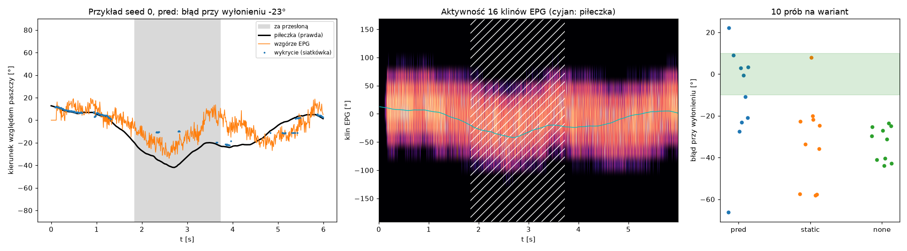

Scena: piłeczka y₀ ∈ [0,12; 0,16] m, v ∈ [0,09; 0,12] m/s w poprzek, przesłona 4–8 cm z boku osi; ramię (z kamerą) śledzi piłeczkę i podczas zasłonięcia obraca się wg wzgórza.
Miara: **różnica azymutów piłeczki i paszczy (od osi bazy) w chwili wyjścia piłeczki zza przesłony** (geometria odcinka kamera → piłeczka przez prostopadłościan przesłony,
niezależna od pola widzenia); sukces = |błąd| < 10°. Zasłonięcie trwa średnio 1,73 s (pred). Pełne wyniki strojenia i walidacji (błędy każdej próby), także sekcja „po poprawce startu odczytu DN”: `results/stage3_A_tune_val.txt`.
Wyniki sprzed poprawki: `results/pre_dn_fix/`. **Wszystkie liczby w tabeli poniżej są po poprawce startu odczytu DN, poza strojeniem.**

| zbiór | wariant | sukces (< 10°) | \|b\| < 20° | mediana \|b\| | średni b |
|---|---|---|---|---|---|
| **test 0–9** | **pred** | **4/10** (17–69 %) | 5/10 (24–76 %) | 15,9° | −11,2° |
| | static | 1/10 | 1/10 | 29,2° | −32,4° |
| | none | 0/10 (0–28 %) | 0/10 | 30,5° | −33,0° |
| strojenie 100–119 (**sprzed poprawki, nie przeliczano**) | pred | 11/20 (34–74 %) | — | 9,5° | — |
| | static / none | 1/20 / 0/20 | — | — | — |
| walidacja 120–139 | pred | **9/20** (26–66 %) | 12/20 (39–78 %)\* | 15,5° | −13,6°\* |
| | static | 0/20 (0–16 %) | — | 27,2° | — |
| | none | 0/20 (0–16 %) | — | 33,9° | — |

\* policzone przeze mnie z listy błędów walidacji `pred` (−19, −28, 1, 0, −9, 1, −4, −23, −9, 18, −33, −32, −5, −41, −23, −13, −21, 0, −25, −7).
Błędy `pred`, test 0–9 (°, seedy 0…9): −23, 9, 22, −66, −11, −21, 3, −1, −27, 3. Ucieczek fałszywych w teście: 0 w żadnym wariancie.
Znak: błąd ujemny = piłeczka jest dalej na swojej drodze niż paszcza, czyli ramię zostaje w tyle.

Rozbicie błędu `pred` w teście po poprawce: pamięć pierścienia (prawda − wzgórze) −26, 55, 56, −58, −8, −18, 14, 58, −31, 31°; ramię względem wzgórza 3, −46, −34, −8, −3, −2, −11, −58, 4, −27°.
Średnia |błąd pamięci pierścienia| na teście wynosi 35,5° (przed poprawką 22,5°; oba wg moich obliczeń z list), czyli **sama pamięć pierścienia nie jest po poprawce dokładniejsza**; przyczyny nie badano.
Przed poprawką, na seedach 110–119 (pomiar z sesji), pamięć pierścienia miała średni błąd −2°, a ramię było średnio 10° za wzgórzem; dryf wzgórza w pamięci wynosił ~12–15° na 1,5–1,9 s, bez stałego przesunięcia.

**Wnioski i zastrzeżenia.**
1. `pred` jest lepsze od `static` i `none` w teście (mediana 15,9° vs 29,2° vs 30,5°; sukces 4/10 vs 1/10 vs 0/10) i na walidacji (9/20 vs 0/20 vs 0/20; mediany 15,5° vs 27,2° vs 33,9°).
   Na walidacji przedziały `pred` (26–66 %) i `static` (0–16 %) są rozłączne; przed poprawką były nierozłączne (5/20 vs 3/20). Na teście 4/10 (17–69 %) vs 1/10 (2–40 %) zachodzą na siebie.
2. **Poprawka powstała po obejrzeniu wyników testowych**, więc ani test 0–9, ani walidacja 120–139 nie są niezależnym sprawdzianem. Test 0–9 był ponadto używany w rozwoju na starszej wersji kodu.
   Poprawa walidacji (5/20 → 9/20) mieści się w przedziałach (11–47 % vs 26–66 %).
3. Sukces w sensie < 10° pozostaje **rzadki** (4/10 na teście, 9/20 na walidacji). Mediana błędu 15,5–15,9° jest wyższa niż przed poprawką na teście (12,0°) i niższa na walidacji (18,4°).
   Na teście „< 20°” spadło z 8/10 do 5/10.
4. Jeden seed (3) ma błąd −66° przy pamięci pierścienia −58°: awaria samej pamięci (przed poprawką: seed 2, −67°/−64°). Przyczyny nie badałem.
5. Test mierzy kierunek w chwili wyłonienia, nie ponowne złapanie celu. Na wykresie przykładowym (seed 0, błąd −23°) wykrycia wracają po wyłonieniu i wzgórze podąża za piłeczką;
   wcześniejsze zastrzeżenie (przykład sprzed poprawki: ramię nie podjęło piłeczki po wyłonieniu) nie dotyczy już tego wykresu, ale nie sprawdzano jego częstości w pozostałych próbach.

### B1. Ucieczka przed zbliżającym się obiektem

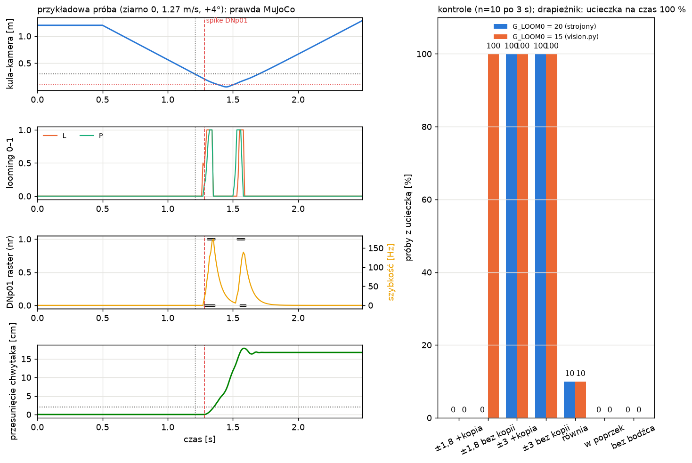

Scena: czarna kula r = 8 cm startuje 1,2 m od kamery, kierunek lotu w ±15° od osi kamery, po 0,5 s ciszy leci po prostej na stałą kamerę z prędkością U(1,0; 2,0) m/s
(zmierzone na seedach 0–9: 1,24–1,99 m/s). Obwód: looming (przyrost obszaru OFF w 50 ms, próg G_LOOM0 = 20, pełna skala G_LOOM0 + 24) → LC4/LPLC2 (danymi: 1587 i 1183 synaps do DNp01)
→ DNp01 → program ucieczki. Rozdzielczość czasu 10 ms.

Sukces = pierwszy spike DNp01 po starcie kuli i zanim środek kuli zbliży się do kamery na ≤ 0,10 m (powierzchnia kuli 2 cm od kamery). Seedy 0–9, jeden przebieg:

| miara | wynik (n = 10) |
|---|---|
| sukces (spike w oknie) | **10/10**; spike przed startem 0; brak spike’a 0; za późno 0 |
| odległość kuli przy spike’u | **0,214 ± 0,010 m** [0,200…0,233] |
| opóźnienie od chwili 0,30 m | **53 ± 16 ms** [30…70] |
| opóźnienie od pierwszej klatki loom > 0 | 23 ± 10 ms [10…40] |
| spike → chwytak odsunięty o 2 cm | **80 ± 0 ms**; odległość kuli wtedy 0,107 ± 0,021 m [0,068…0,129] |
| odsunięcie o 2 cm zdążyło przed 0,10 m | **6/10** (tylko raport, bez strojenia) |

Odsunięcie o 2 cm zajmuje stałe 80 ms we wszystkich próbach (rozdzielczość 10 ms; ograniczenie serwa, nie sieci). Ponieważ kula jest już w 4/10 prób bliżej niż 0,10 m w chwili odsunięcia,
„sukces” 10/10 jest miarą zdarzenia neuronalnego (spike DNp01), a nie unikniętego kontaktu.

Kontrole fałszywych ucieczek (3 s po 0,5 s ciszy; odsetek prób z jakimkolwiek spike’em DNp01, n = 10):

| kontrola | G_LOOM0 = 20 (finalne) | G_LOOM0 = 15 (odniesienie bez strojenia) |
|---|---|---|
| (a) obrót własny ±1,8 rad/s, kopia eferentna TAK | 0 % | 0 % |
| (a) obrót własny ±1,8 rad/s, kopia eferentna NIE | **0 %** (max looming 0,33) | **100 %** |
| (a′) obrót własny ±3 rad/s, kopia TAK | **100 %** | 100 % |
| (a′) obrót własny ±3 rad/s, kopia NIE | 100 % | 100 % |
| (b1) piłeczka z równi do paszczy | **10 %** (1/10) | 10 % |
| (b2) piłeczka w poprzek bez przesłony | 0 % | 0 % |
| (c) sama scena, bez bodźca | 0 % | 0 % |

Odniesienie G_LOOM0 = 15: odsunięcie na czas 7/10, spike 0,229 ± 0,014 m, opóźnienie od 0,30 m 43 ± 16 ms. Strojenie G_LOOM0 15 → 20 (jedyny strojony parametr) wykonano na seedach 100–119, sprawdzono na 120–139:
komentarz w `vision.py` podaje fałszywą ucieczkę z równi w 8/40 prób przy 15, 2/40 przy 20 i 0/40 przy 25, ale przy 25 spike przychodzi o 1,3 cm później, a odsunięcie na czas udaje się w 28/40 zamiast 36/40.

**Zastrzeżenia.**
1. Cena strojenia: przy G_LOOM0 = 20 **kopia eferentna przestaje rozstrzygać w kontroli (a)** (0 % z kopią i bez niej), więc jej wkładu nie wykazuje ten test; przy 15 działała (0 % vs 100 %). Przy ±3 rad/s fałszywa ucieczka jest zawsze (100 %).
2. Zbliżenie piłeczki z równi do paszczy — dokładnie sytuacja B2 — daje 10 % fałszywych ucieczek. Plik wyników B2 nie raportuje ucieczek, więc nie wiem, czy któraś z 10 prób B2 je zawierała.
3. Próg G_LOOM0 został ustawiony z pomiarów tej sceny (`vision_calib.py`), więc „detektor” jest dopasowany do kuli r = 8 cm i prędkości 1–2 m/s.
4. Drapieżnik to jedyna kula o jednej wielkości i kontraście; nie testowano kształtów ani tła o słabym kontraście.

### B2. Chwyt piłeczki prowadzony wzrokiem

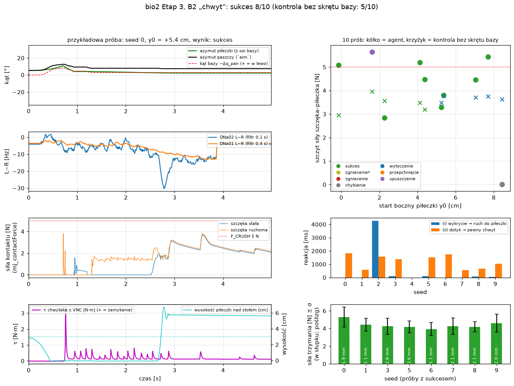

Scena: piłeczka stacza się z równi 12° (długość 0,16 m, start na 0,85 długości) w stronę paszczy; boczne przesunięcie startu y₀ ∈ [−1; 9] cm (zakres dobrany tak, by tylko część położeń trafiała w paszczę bez skrętu bazy);
T = 5 s; maksymalna prędkość bazy zmniejszona do W_MAX = 0,6 rad/s (przy 1,0 baza spychała piłeczkę). Agent: siatkówka → EPG → DNa02/DNa01 skręcają bazę → dotyk → VNC zamyka szczęki → uniesienie.
Miary z kontaktów MuJoCo: sukces = środek piłeczki ≥ 3 cm nad stołem przez okno 1 s i obie szczęki w kontakcie w ≥ 99 % kroków; zgniecenie = średnia 20 ms siły normalnej szczęka–piłeczka > 5 N.

**Nowa definicja reakcji (i):** od pierwszego wykrycia celu przez agenta (`log["seen"]`) do obrotu bazy o ≥ 1° od startu w stronę piłeczki, utrzymanego ≥ 50 ms.
Dawna miara (od widoczności w segmentacji do |ω| > 0,05 rad/s przez ≥ 30 ms) mierzyła impuls opisany w „Poprawce startu odczytu DN” i została zarzucona.

Seedy 0–9, jeden przebieg, **po poprawce** (przed poprawką w nawiasach; plik: `results/stage3_b2.txt`, wersja sprzed: `results/pre_dn_fix/stage3_b2.txt`):

| miara | wynik |
|---|---|
| **sukces** | **8/10** (49–94 %) (przed: 6/10); seedy 0, 1, 3, 5, 6, 7, 8, 9. Porażki: **1 upuszczenie** (seed 2), **1 chybienie** (seed 4: piłeczka nigdy nie dotknęła ramienia; baza obróciła się o 105°). Przed poprawką: 3 przepchnięcia, 1 upuszczenie |
| zgniecenia (średnia 20 ms) | **0/10**; szczyt chwilowy (1 ms) > 5 N w 4/10 (seedy 1, 2, 3, 9; max 5,65 N, seed 2) |
| reakcja (i) wykrycie → obrót bazy do piłeczki | **920 ± 1675 ms (n = 5)**; wartości 50, 80, 100, 100 i 4270 ms (przed: 1590 ± 1778 ms, n = 7) |
| dotyk → pewny chwyt (obie szczęki ≥ 0,3 N przez 50 ms) | 1210 ± 486 ms (n = 9) |
| siła trzymania | 4,39 ± 0,39 N, CV 0,19 ± 0,03 (n = 8) |
| poślizg piłeczki w oknie trzymania | 2,6 ± 1,0 mm (n = 8), maks. odchylenie 1,8 ± 0,6 mm |
| szczyt siły | chwilowy 4,5 ± 0,9 N, średnia 20 ms 3,5 ± 0,4 N (n = 9) |

**Kontrola z zablokowaną bazą** (te same seedy; bez odczytu DN, więc bez zmian po poprawce): **5/10** (24–76 %), seedy 1, 2, 3, 6, 8; 5 wytoczeń; 0 zgnieceń; szczyt chwilowy > 5 N: 0/10.

**Zastrzeżenia.**
1. **Poprawka i wynik 8/10 powstały po obejrzeniu wyników testowych** na tych samych seedach. 8/10 (49–94 %) vs kontrola 5/10 (24–76 %): przedziały zachodzą na siebie, więc przewaga skrętu jest sugerowana, nie wykazana.
   Zestawienie prób: z 5 wytoczeń kontroli skręt ratuje 4 (seedy 0, 5, 7, 9), a seed 4 kończy się chybieniem; seed 2, udany bez skrętu, kończy się upuszczeniem.
2. **Reakcja (i) jest słabą miarą.** Kryterium spełnia tylko 5 z 10 prób (w pozostałych nie zostało spełnione; przyczyn w poszczególnych próbach nie badałem), rozrzut jest ogromny (SD 1675 ms przy średniej 920 ms),
   a wartość ~4 s (seed 2) to pościg za odbitą piłeczką, nie reakcja na pierwsze pojawienie się. Cztery pozostałe wartości to 50–100 ms. Średnia 920 ms nie jest typowym czasem reakcji.
3. **Baza nadal w niektórych próbach skręca o kilka stopni od piłeczki.** Hipoteza (niezweryfikowana): kierunek celu liczony jest jako przecięcie promienia kamery ze stołem na wysokości promienia piłeczki, a piłeczka na równi leży wyżej, więc przecięcie jest obciążone.
   Nie sprawdzałem też, czy chybienie w seedzie 4 (obrót bazy o 105°) ma ten sam mechanizm.
4. Szczyty chwilowe 1 ms > 5 N pojawiają się tylko z aktywną bazą (4/10, kontrola 0/10). Zgnieceń w sensie 20 ms nie ma, ale seedy 1, 2, 3 i 9 mają szczyt chwilowy 5,08–5,65 N.
5. Siła trzymania 4,4 N jest wyższa niż w v4 (2,4–3,1 N), a czas dotyk → chwyt (1210 ms) dłuższy niż w v4 (981 ms). Sceny nie są identyczne (inne przesunięcie boczne, W_MAX 0,6), więc nie porównywałbym wyników wprost z v4 (8/10, 26/30).
6. Wyniki strojenia (100–119) i walidacji (120–139) dla B2 nie są zapisane w plikach wynikowych; plik ma tylko seedy 0–9.

## Co nie działało i dlaczego (usterki znalezione i poprawione w Etapie 3)

1. **Krawędzie bliskiej przesłony brane za cel.** Przy obrocie bazy paralaksa przesuwa krawędzie przesłony, które wyglądały jak mały poruszający się obiekt.
   Poprawka: filtr zwartej plamki — kandydat musi mieć 4–40 komórek, proporcje ≤ 2·w + 1 (krawędzie przesłony to paski h 13–16 × w 2–4 komórki) i krawędzie ON **i** OFF jednocześnie (każda ≥ 15 % sumy; toczący się obiekt ma obie, krawędź przesłony jedną).
2. **Kierunek celu z kamery zamiast z osi bazy.** Kamera siedzi ~25 cm od osi obrotu, więc kierunek do bliskiej piłeczki zmienia się przy obrocie bazy ~2,3× szybciej niż kąt bazy;
   kompensacja PEN „−prędkość bazy” była za słaba, a pętla wzrokowa za silna. Poprawka: promień kamery ∩ stół (azymut z osi bazy).
3. **Odczyt DNa02 skalibrowany przy bodźcu miał w stanie pamięci inny trym** (seed 100: wzgórze średnio na 5°, odczyt 10°; w `brain.py`: trym o 3–5 Hz i ok. 2× większe nachylenie). Przy złej kalibracji ramię obracało się bez końca.
   Poprawka: osobna kalibracja dla pamięci (`offset_mem`, `slope_mem`).
4. **Resztka przepływu przez HS → DN dawała skręty o złym znaku** (3–4 rad/s), bo odejmowanie przewidywanego przepływu nie wystarcza przy paralaksie. Poprawka: HS wygaszane, gdy |ω bazy| > 0,05 rad/s
   (u muchy sygnał ruchowy kasuje odpowiedź HS podczas skrętów dobrowolnych — Kim i in. 2015, 2017).
5. **Zbyt rzadka kalibracja prędkości pierścienia** (4 powtórzenia dawały błąd średniej prędkości ~7°/s, czyli ~13° błędu pamięci po 1,9 s). Poprawka: 12 powtórzeń i gęsta siatka komend wokół u ≈ −0,3 (tam wypada prędkość 0).
6. **Renderer MuJoCo bez `close()` przy nowym `MjModel` w tym samym procesie renderował błędne klatki** (wykrył to subagent przy B1; komentarze w `vision_calib.py` i `stage3_b1.py`).
   Po poprawce wyniki A przeliczone: identyczne (pomiar z sesji).
7. **Fałszywe ucieczki przy własnym obrocie i przy piłeczce z równi** (próg G_LOOM0 = 15): zmniejszone przez podniesienie progu do 20 — kosztem opisanym w B1.
8. **Spontaniczne wzgórze EPG z szumu obracało ramię, zanim pojawił się cel.** Rozwiązanie modelowe: stan „polowanie” (OA-VUM) i tłumienie pierścienia w spoczynku (`rest_inh`).
9. **Nierozróżnialny pierścień z surowych wag** (tylko 2 położenia wzgórza) — rozwiązanie opisane w Etapie 2 B (profile zamiast macierzy).
10. **Start filtra odczytu DN od zera dawał impuls skrętu ~0,5 rad/s w lewo przy zatrzaśnięciu na celu** (wykryty przy B2, bo dawna miara reakcji 272 ± 34 ms była identyczna w każdej ablacji). Poprawka: `dn_f` = trym poza stanem „polowanie + zatrzaśnięcie”. **Wprowadzona po obejrzeniu wyników testowych** — patrz „Poprawka startu odczytu DN” (liczby przed i po).

## Ograniczenia

- Wszystko w symulacji; fizyka tarcia, opór toczenia (10⁻⁵ m), sztywność serw i szum kamery to wartości przyjęte, nie zmierzone na sprzęcie.
- Próby małe (n = 10, na strojeniu i walidacji A n = 20). Przedziały Wilsona 95 %, policzone przeze mnie z liczników (po poprawce): A test pred 4/10 → 17–69 %, „< 20°” 5/10 → 24–76 %; A walidacja pred 9/20 → 26–66 %, static 0/20 → 0–16 %;
  A strojenie (sprzed poprawki) pred 11/20 → 34–74 %; B2 8/10 → 49–94 %, kontrola 5/10 → 24–76 %. Przedziały pred i static na teście oraz B2 i kontrola **zachodzą na siebie**; na walidacji A są rozłączne.
- **Poprawka odczytu DN powstała po obejrzeniu wyników testowych** (A i B2, seedy 0–9; walidacja A 120–139 też była widziana przed nią). Wyniki po poprawce nie są niezależnym sprawdzianem; strojenia A 100–119 po poprawce nie przeliczano.
  Dawny wynik reakcji (i) 272 ± 34 ms był artefaktem impulsu skrętu i nie należy go cytować.
- Kontrole „static/none” i „zablokowana baza” dowodzą, że pamięć/skręt coś dają w tej scenie, ale nie izolują wkładu poszczególnych elementów obwodu; Etap 4 ablatuje neurony losowo i warstwowo, bez nokautów pojedynczych typów.
- Wiele kluczowych elementów jest modelowe (przewidywanie celu, OA-VUM, uwaga odgórna, dekodery, kalibracje, detektory wzrokowe); konektom dostarcza tożsamość, znak i liczbę połączeń oraz kształt profili w CX, a nie dynamikę obliczeń.
- Wzgórze EPG w pamięci dryfuje ~12–15° na 1,5–1,9 s (pomiar sprzed poprawki); całkowanie obrotu ma błąd do ±22° SD i systematycznie przestrzela przy +45°/s.
- Test A mierzy kierunek w chwili wyłonienia, nie ponowne złapanie celu; przed poprawką ramię nie zawsze podejmowało piłeczkę po wyłonieniu (przykład seed 0), a częstości po poprawce nie sprawdzano. Sukces < 10° jest rzadki (4/10 na teście, 9/20 na walidacji), a „< 20°” na teście spadło po poprawce z 8/10 do 5/10.
- B1: 100 % fałszywych ucieczek przy obrocie własnym ±3 rad/s i 10 % przy piłeczce z równi; odsunięcie chwytaka o 2 cm zdążyło tylko w 6/10 prób.
- B2: 8/10 (przed poprawką 6/10), porażki: upuszczenie 1, chybienie 1 (baza obróciła się o 105°); bez wykazanej przewagi nad blokadą bazy (5/10). Baza w niektórych próbach nadal skręca o kilka stopni od piłeczki (hipoteza, niezweryfikowana: przecięcie promienia ze stołem na wysokości promienia piłeczki, a piłeczka na równi leży wyżej).
  Reakcja (i) w nowej definicji: 920 ± 1675 ms z n = 5 z 10, wartość ~4 s to pościg za odbitą piłeczką.
- Test A na seedach 0–9 wykorzystywano wcześniej w rozwoju na starszej wersji kodu.
- Etap 4: B1 10/10 przy każdej lezji wynika z reguły (≥ 1 LC4/LPLC2 na stronę, DNp01 nigdy nie lezjonowany) i z modelowo wstrzykiwanego loomingu, więc nie świadczy o odporności; brak nokautów pojedynczych typów;
  seed = lezja = szum = scena (jedno losowanie lezji na seed); zamknięta pętla tylko dla 292/120/50; skalowanie synaptyczne to niestrojona reguła modelowa; przy martwym wzgórzu skręt = 0 z konstrukcji dekodera.

- Etap 5, autentyczność: CX jest gęsty (69 % par, EPG → EPG 2070/2070), więc informację niosą profile wag, nie graf; REWIRE przestawia tylko 20–27 % krawędzi; looming jest wejściem modelowym (B1 testuje tylko istnienie krawędzi LC4/LPLC2 → DNp01); 63/64 trafionych przewidywań wynika w dużej mierze z szerokich przedziałów; B2 przy n = 10 nie rozstrzyga.
- Etap 5, rzucana piłeczka: zakres rzutów to wąski pas (r 0,20–0,36 m, z 0,22–0,34 m, oś ≤ 20°; akceptowane 24,6 % losowań), nie dowolne miejsce; percepcja i planowanie to inżynieria (kamera 320×240, bo siatkówka 32×24 jest za słaba), wrażliwa na synchronizację rzędu 1 ms i kalibrację rzędu 0,25°; łapanie zawdzięczamy inżynierii (ENG 94–98 %), a mózg wnosi tylko z modelowymi łatkami (odczyt ON, tłumienie ucieczki w polowaniu, maska eferentna) i nie poprawia wyniku; wszystko w symulacji.

## Etap 4 — ablacja neuronów

Pytanie: ile neuronów układu 292 (mózg 220 + VNC 72) można usunąć, zanim zadania Etapu 3 przestaną działać. Wyniki: `results/stage4.txt`
(zamknięta pętla), `results/stage4_openloop.txt` (otwarta pętla, sam pierścień EPG). Źródła kodu: `ablation.py`, `stage4.py`.
**Zamknięta pętla jest przeliczona po poprawce startu odczytu DN** (patrz Etap 3); wersja sprzed poprawki: `results/pre_dn_fix/stage4.txt`, `stage4_closed.jsonl`, `stage4_parts.jsonl`. Otwarta pętla nie korzysta z odczytu DN i nie zmieniła się.

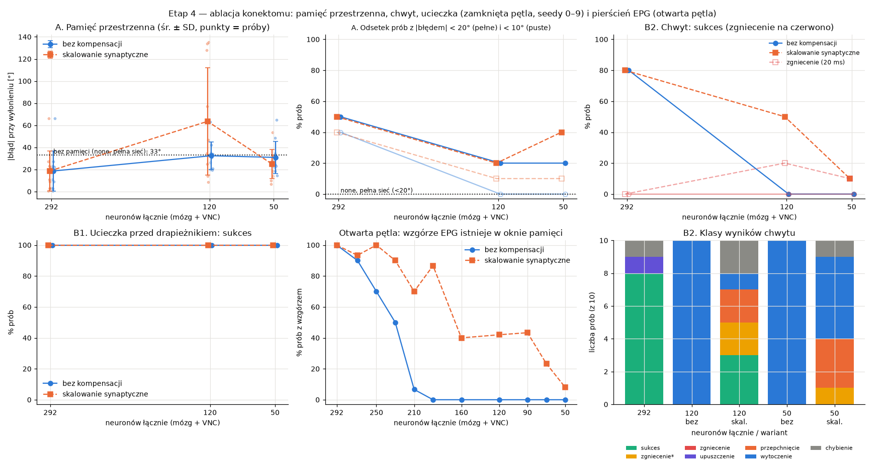

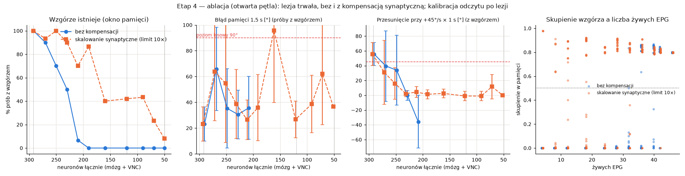

### Protokół

**Lezja, nie kompensacja.** Usunięty neuron jest martwy na stałe: jego wiersz i kolumna w macierzy wag są zerami, nie dostaje prądu zewnętrznego
(jest wycięty z grup wejść) i jego spike’i są maskowane. W wariancie podstawowym („bez komp.”) wagi pozostałych **nie są skalowane**, a stałe nie są przestrajane.
Jedyna ingerencja po lezji to **ponowna kalibracja odczytu** (`calibrate_ring` i `calibrate_steer`, czyli odwrócona krzywa prędkość wzgórza → komenda u oraz trym i nachylenie DNa02/DNa01).
To kalibracja dekodera, a nie sieci: nie dodaje synaps i nie zmienia wag.

**Zabezpieczenie nachylenia dekodera** (`LesionedBrain.calibrate_steer`). Przy martwym wzgórzu regresja L−P na kąt wzgórza daje nachylenie 0 lub nieskończone.
Bez zabezpieczenia agent dzielił przez 0, w sterowaniu pojawiał się NaN, MuJoCo zerował wszystkie komendy, a ramię skakało do q = 0 — artefakt numeryczny, nie skutek lezji.
Teraz nachylenie zerowe lub nieskończone zamieniam na ∞, czyli odczyt skrętu wynosi 0 (dekoder nie niesie informacji). To jedyna ingerencja w odczyt po lezji
i ma konsekwencję: przy martwym wzgórzu baza **z założenia** nie skręca.

**Reguła wyboru neuronów** (losowanie warstwowe, `allocation`). 46 warstw: 30 w mózgu (typ komórki × strona L/R) i 16 w VNC (populacje chwytu, z bramką RR_gate rozbitą na szczękę stałą i ruchomą).
Każda warstwa zachowuje ≥ 1 neuron; resztę rozdziela się proporcjonalnie do rozmiaru warstwy (water-filling). **Przydział jest deterministyczny**, a ziarno wybiera tylko, *które* neurony zostają.
Warstwy jednoneuronowe (DNa01/02, DNp01/09, HSN/HSE/HSS, płytka włoskowa, RR_gate ×2) nigdy nie są lezjonowane. Poziomy: **292** (pełny), **120**, **50**.
Przy 120 zostaje 18 EPG, 16 PEN i 16 Delta7, a przy 50 po 4 EPG, PEN i Delta7 oraz po 1 neuronie w każdej pozostałej warstwie (w tym po 1 LC4 i 1 LPLC2 na stronę).
Z VNC zostaje przy 120 np. 2 z 5 MN zginacza i 2 z 6 neuronów RR_resist, a przy 50 po jednym.

**Wariant „skalowanie” (kompensacja synaptyczna, założenie modelowe, niestrojone).**
Mózg: wagi wejściowe od każdej warstwy × min(n_pełne / n_żywe, 10). VNC: wagi wyjściowe ocalałych z populacji × n_pełne / n_żywe (bez limitu) i siła skurczu ocalałych MN × to samo (reinerwacja kolateralna).
Na poziomie 292 skala = 1, więc oba warianty są tam identyczne (liczone raz).

**Zamknięta pętla.** Seedy 0–9; **seed próby = losowanie lezji = ziarno szumu = scena** (te same scenariusze A, B1, B2 co w Etapie 3, parametry zamrożone, nic nie strojono).
Każdy scenariusz dostaje *świeży* mózg i VNC (to samo losowanie lezji, kalibracja od nowa), tak jak w Etapie 3. Wszystkie liczby są surowe, bez wykluczeń:
próba, w której piłeczka nie wyszła zza przesłony lub scenariusz zgłosił błąd techniczny, liczy się jako porażka (błędów technicznych: brak).
**Poziom 292 odtwarza Etap 3 (po poprawce) dokładnie**: błędy A (`pred` i `none`), B2 8/10 z tymi samymi klasami i 920 ± 1675 ms (n = 5), B1 10/10 z 53 ± 16 ms są identyczne z plikami Etapu 3. Wariant z jednym mózgiem przez kolejne A → B1 → B2 odrzucono, bo B2 dawał w nim 4/10: pojedyncza próba jest czuła na realizację szumu (pomiar z sesji).
Wariant z jednym mózgiem przez kolejne A → B1 → B2 odrzucono, bo B2 dawał w nim 4/10: pojedyncza próba jest czuła na realizację szumu (pomiar z sesji).

### A. Pamięć przestrzenna (błąd azymutu przy wyłonieniu, sukces |błąd| < 10°; n = 10; po poprawce odczytu DN)

W nawiasach przedziały Wilsona 95 % (obliczone z liczników); „przed” = wynik sprzed poprawki startu odczytu DN (`results/pre_dn_fix/stage4.txt`).

| układ | \|b\| < 10° (przed) | \|b\| < 20° (przed) | mediana \|b\| | śr. \|b\| ± SD | śr. b | „bez wzgórza” |
|---|---|---|---|---|---|---|
| 292, bez pamięci (`none`) | 0/10 (0–28 %) (0/10) | 0/10 (1/10) | 30,5° | 33,0 ± 7,8° | −33,0° | 0 |
| **292, `pred`** | **4/10** (17–69 %) (3/10) | 5/10 (24–76 %) (8/10) | 15,9° | 18,6 ± 18,3° | −11,2° | 0 |
| 120, bez komp. | 0/10 (0–28 %) (0/10) | 2/10 (6–51 %) (2/10) | 31,6° | 32,5 ± 12,4° | −32,5° | **10** |
| 120, skalowanie | 1/10 (2–40 %) (1/10) | 2/10 (6–51 %) (5/10) | 40,6° | **63,5 ± 48,4°** | −49,2° | 3 |
| 50, bez komp. | 0/10 (0–28 %) (0/10) | 2/10 (6–51 %) (2/10) | 26,1° | 30,9 ± 14,4° | −30,9° | **10** |
| 50, skalowanie | 1/10 (2–40 %) (1/10) | 4/10 (17–69 %) (4/10) | 25,6° | 25,0 ± 13,0° | −25,0° | **10** |

„Bez wzgórza” = w chwili wyłonienia kąt wzgórza jest dokładnie 0, czyli EPG nie wygenerowały spike’ów (`stage4.py`). Ucieczek fałszywych: 0 we wszystkich wierszach; wszystkie próby wyłoniły się zza przesłony (10/10).

- Bez kompensacji **pamięć znika całkowicie już przy 120 neuronach**: martwe wzgórze w 10/10 prób, a średni błąd (32,5°) jest taki jak bez pamięci (`none`: 33,0°). To samo przy 50 (30,9°).
- Ze skalowaniem przy 120 wzgórze częściej istnieje (martwe w 3/10), ale **jakość pamięci nie wraca**: mediana 40,6° i średnia |b| 63,5° są **gorsze niż bez pamięci** (30,5° i 33,0°),
  bo trzy próby mają błąd od −128° do −135°, a jedna −77° (błędy: −134, −9, −77, −47, 14, −128, 33, 25, −135, −35). Ramię działa wtedy na fałszywym kierunku, a nie tylko go nie zna.
- Ze skalowaniem przy 50 wzgórze jest martwe w 10/10 prób, a błąd (25,0 ± 13,0°) nie różni się od `none` (33,0 ± 7,8°) przy n = 10; „< 20°” 4/10 vs 0/10 ma zachodzące przedziały (17–69 % vs 0–28 %).
- Przedziały pełnego układu i lezji zachodzą na siebie przy kryterium < 10° (4/10: 17–69 % vs 0–1/10: 0–40 %). Przy „< 20°” pełny układ 5/10 (24–76 %) zachodzi na wszystkie wiersze lezji (2–4/10).
  Po poprawce różnica pełny–lezje jest więc mniej wyraźna niż przed nią (8/10 vs 2–5/10).

### B2. Chwyt (n = 10; po poprawce odczytu DN)

Reakcja (i) w nowej definicji (od wykrycia celu do obrotu bazy ≥ 1° w stronę piłeczki, utrzymanego ≥ 50 ms); n w nawiasie to liczba prób, w których kryterium spełniono.

| układ | sukces (przed) | zgniecenie (średnia 20 ms) | szczyt 1 ms > 5 N | reakcja (i) | klasy |
|---|---|---|---|---|---|
| **292** | **8/10** (49–94 %) (6/10) | 0/10 | 4/10 | 920 ± 1675 ms (n = 5) | sukces 8, upuszczenie 1, chybienie 1 |
| 120, bez komp. | 0/10 (0–28 %) (0/10) | 0/10 | 0/10 | 235 ± 144 ms (n = 4) | wytoczenie 10 |
| 120, skalowanie | 5/10 (24–76 %) (3/10) | **2/10** | 5/10 | 737 ± 817 ms (n = 7) | sukces 3, przepchnięcie 2, zgniecenie\* 2, chybienie 2, wytoczenie 1 |
| 50, bez komp. | 0/10 (0–28 %) (0/10) | 0/10 | 0/10 | 1655 ± 1425 ms (n = 2) | wytoczenie 10 |
| 50, skalowanie | 1/10 (2–40 %) (0/10) | 1/10 | 2/10 | 262 ± 175 ms (n = 5) | wytoczenie 5, przepchnięcie 3, chybienie 1, zgniecenie\* 1 |

(zgniecenie\* = piłeczka uniesiona, ale średnia siła 20 ms > 5 N; wchodzi do „sukcesu”, więc bez zgniecenia jest 3/10 przy 120 ze skalowaniem i 0/10 przy 50 ze skalowaniem.)
Reakcję (i) podaję dla kompletności; przy martwym wzgórzu baza nie powinna skręcać z woli sterownika, więc wartości w wierszach „bez komp.” (n = 2–4) nie interpretuję (mogą wynikać z fizycznych kontaktów; nie sprawdzano). Zastrzeżenia jak w B2 Etapu 3.

Rozbicie diagnostyczne (ta sama lezja tylko w mózgu przy pełnym VNC albo tylko w VNC przy pełnym mózgu; łączne N wtedy nie obowiązuje; przed poprawką w nawiasach):

| układ | lezja tylko mózg | lezja tylko VNC |
|---|---|---|
| 120, bez komp. | 6/10 (31–83 %) (4/10): sukces 6, wytoczenie 4 | **0/10** (0–28 %) (0/10): przepchnięcie 9, chybienie 1 |
| 120, skalowanie | 4/10 (17–69 %) (5/10): przepchnięcie 3, sukces 3, chybienie 2, zgniecenie\* 1, upuszczenie 1 | 4/10 (17–69 %) (5/10): przepchnięcie 4, sukces 3, zgniecenie\* 1, upuszczenie 1, chybienie 1 |
| 50, bez komp. | 5/10 (24–76 %) (6/10): sukces 5, wytoczenie 5 | **0/10** (0–28 %) (0/10): przepchnięcie 9, chybienie 1 |
| 50, skalowanie | 6/10 (31–83 %) (4/10): sukces 6, wytoczenie 3, chybienie 1 | **0/10** (0–28 %) (3/10): przepchnięcie 7, upuszczenie 2, chybienie 1 |

- **0/10 bez kompensacji wynika z lezji VNC, nie mózgu.** Przy lezji tylko VNC wynik to 0/10 (przepchnięcie 9, chybienie 1; klasa „przepchnięcie” = bez pewnego chwytu, piłeczka odepchnięta ruchem chwytaka), przy lezji tylko mózgu 6/10 i 5/10.
- **Sam martwy mózg działa jak kontrola „zablokowana baza” z Etapu 3** (5/10 z 5 wytoczeniami): 6/10 i 5/10 mieszczą się w tym samym przedziale, a porażki to wytoczenia. Wynika to także z konstrukcji (martwe wzgórze → skręt = 0).
- Skalowanie w VNC poprawia chwyt przy lezji tylko VNC przy 120 neuronach (0/10 → 4/10), ale **nie przy 50** (0/10: przepchnięcie 7, upuszczenie 2, chybienie 1; przed poprawką 3/10).
  Zgniecenia pojawiają się tylko w wariantach ze skalowaniem (2/10 przy 120 w układzie łącznym, 1/10 przy 50 łącznym; po 1/10 w rozbiciu „120, tylko mózg” i „120, tylko VNC”); przyczyn nie badano.
- **Komórki n = 10 są niestabilne.** Poprawka odczytu DN zmieniła wyniki także tam, gdzie wzgórze jest martwe i skręt powinien wynosić 0 (np. „120, bez komp., tylko mózg” 4/10 → 6/10; „50, skalowanie, tylko VNC” 3/10 → 0/10).
  Przyczyny nie wyjaśniono; różnice o 2–3 próby między komórkami nie niosą informacji.

### B1. Ucieczka (n = 10)

| układ | sukces (spike DNp01 przed 0,10 m) | spike przed startem kuli | opóźnienie od 0,30 m |
|---|---|---|---|
| 292 | **10/10** (72–100 %) | 0/10 | 53 ± 16 ms |
| 120, bez komp. | 10/10 | 0/10 | 53 ± 16 ms |
| 120, skalowanie | 10/10 | 0/10 | 53 ± 16 ms |
| 50, bez komp. | 10/10 | 0/10 | 55 ± 15 ms |
| 50, skalowanie | 10/10 | 0/10 | 53 ± 16 ms |

**Nie jest to dowód odporności ucieczki na lezje.** B1 przeżywa dlatego, że reguła warstwowa zostawia ≥ 1 LC4 i ≥ 1 LPLC2 na stronę, a DNp01 (warstwa jednoneuronowa) nigdy nie jest lezjonowany.
Wejście loomingu jest dodatkowo wstrzykiwane modelowo prądem do LC4/LPLC2 (obliczenie loomingu robi algorytm w `vision.py`, a nie neurony), więc test sprawdza tylko transmisję LC4/LPLC2 → DNp01 przez jedną komórkę.
Ucieczki przy lezji samego DNp01 lub wszystkich LC4/LPLC2 danej strony ta ablacja nie obejmuje.

### Otwarta pętla: pierścień EPG (samo wzgórze, bez MuJoCo)

Protokół Etapu 2 B (bodziec 0,3 s, 1,5 s ciemności, +45°/s przez 1 s, 0,5 s spoczynku, −30°/s przez 1 s); 10 losowań lezji × 5 ziaren szumu na poziomach 292/120/50 (n = 50 prób)
i 10 × 3 na poziomach pośrednich (n = 30). „Wzgórze istnieje” = skupienie w oknie pamięci > 0,5 oraz EPG ≥ 5 Hz.
Przedziały Wilsona w nawiasach traktują próby jak niezależne, a **nie są** (próby z tego samego losowania lezji są skorelowane); zależność od losowania widać niżej.

| N (żywych EPG) | bez komp. [% prób z wzgórzem] | skalowanie [% prób z wzgórzem] |
|---|---|---|
| 292 (46) | 100 (50/50; 93–100 %) | 100 |
| 270 (42) | 90 (27/30; 74–97 %) | 93 (28/30; 79–98 %) |
| 250 (40) | 70 (21/30; 52–83 %) | 100 (30/30; 89–100 %) |
| 230 (36) | 50 (15/30; 33–67 %) | 90 (27/30; 74–97 %) |
| 210 (32) | 7 (2/30; 2–21 %) | 70 (21/30; 52–83 %) |
| 190 (28) | 0 (0/30; 0–11 %) | 87 (26/30; 70–95 %) |
| 160 (24) | 0 | 40 (12/30; 25–58 %) |
| 120 (18) | 0 (0/50; 0–7 %) | 42 (21/50; 29–56 %) |
| 90 (12) | 0 | 43 (13/30; 27–61 %) |
| 70 (8) | 0 | 23 (7/30; 12–41 %) |
| 50 (4) | 0 (0/50; 0–7 %) | 8 (4/50; 3–19 %) |

- Bez kompensacji pierścień załamuje się między 250 a 210 neuronami łącznie (70 % → 7 %); ze skalowaniem utrzymuje się do ~190, a przy 160–90 jest w 40–43 % prób, przy 50 w 8 %.
  Krzywa ze skalowaniem nie jest monotoniczna (np. 70 % przy 210 i 87 % przy 190; 40 % przy 160 i 42 % przy 120) — przy n = 30 to w granicach szumu.
- Zależność od losowania lezji: przy 120 ze skalowaniem „odsetek istnienia na losowanie” to 42,0 ± 47,7 %, a wzgórze istnieje w ogóle w **5 z 10 losowań** (24–76 %);
  przy 50 w **1 z 10** (2–40 %). Wynik zależy więc od tego, *które* neurony przeżyły, a nie tylko ile.
- **Istnienie wzgórza nie oznacza sprawnego całkowania.** Przy 292: błąd pamięci 23,2 ± 13,4° (n = 50; w Etapie 2 było 16,0° na 6 ziarnach — inna próba i kalibracja), przesunięcie +55,8 ± 15,4° przy +45°/s i −17,6 ± 15,3° przy −30°/s,
  poprawny znak obrotu w 84 % prób. Przy 120 ze skalowaniem (21 prób z wzgórzem): błąd pamięci 26,7 ± 14,3°, ale przesunięcie przy +45°/s wynosi **−1,0 ± 6,5°**, przy −30°/s −0,3 ± 5,0°, poprawny znak tylko w 14 % prób;
  przy 50 (4 próby) przesunięcie 0,0 ± 0,0°. Ocalałe wzgórze utrzymuje kierunek, ale nie integruje obrotu. Przy 270 bez komp. i ze skalowaniem błąd pamięci w próbach z wzgórzem rośnie już do 65,8 ± 32,3° i 63,8 ± 38,2°,
  a na wykresie (panel „przesunięcie przy +45°/s”) przesunięcie spada do ok. 0 przy ≤ 230 neuronach (odczyt z wykresu).
- Przy 120 i 50 bez komp. wzgórza nie ma w żadnej próbie (0/50), więc „efektywny” błąd pamięci wynosi z definicji 90°.

### Czego ablacja NIE pokazuje

1. **Nie pokazuje odporności ucieczki B1.** Patrz wyżej: 10/10 wynika z reguły warstwowej (≥ 1 LC4/LPLC2 na stronę, DNp01 nigdy nie lezjonowany) i z wstrzykiwanego loomingu. Nie wolno z tego wnosić odporności biologicznej ani wniosku o redundancji LC4/LPLC2.
2. **Nie wskazuje, które typy neuronów są niezbędne.** Lezje są losowe i proporcjonalne do rozmiaru warstw; nie wykonano nokautów pojedynczych typów (jak w ablacji v1–v3 w `../RESULTS.md`, która dotyczy innego układu, 352 neuronów, i nie jest z tą porównywalna).
   Jedyny podział przyczynowy to mózg vs VNC w B2.
3. **Nie rozdziela wpływu lezji od zmienności sceny i szumu.** Seed = lezja = szum = scena, po jednym losowaniu lezji na seed (10 losowań na poziom). Układ jest sparowany po scenie między poziomami, ale wariancji losowania lezji nie da się oddzielić od wariancji sceny.
4. **Poziomy pośrednie istnieją tylko w otwartej pętli i tylko dla pierścienia.** Zamknięta pętla ma trzy poziomy (292, 120, 50); punkt załamania zadań w zamkniętej pętli (między 292 a 120) nie jest zmierzony.
5. **Przy martwym wzgórzu brak skrętu jest założeniem, nie wynikiem.** Zabezpieczenie nachylenia ustawia skręt = 0, więc „lezja mózgu = zablokowana baza” wynika po części z konstrukcji dekodera.
6. **Kompensacja „skalowaniem” nie jest tezą biologiczną.** To jedna z możliwych reguł (limit 10× w mózgu, brak limitu w VNC), niestrojona; wyniki zależą od niej (zgniecenia, błędy −134° do −136° w A).
7. **Mała liczność** (n = 10 w zamkniętej pętli): przedziały Wilsona w większości zachodzą na siebie, np. B2 292 8/10 (49–94 %) i lezje ze skalowaniem 5/10 (24–76 %); wyraźne są tylko 0/10 (0–28 %) vs 8/10 (49–94 %) oraz 10/10 martwych wzgórz.
8. **Kalibracja odczytu po lezji** (`calibrate_ring`, `calibrate_steer`) może poprawiać lub maskować skutki lezji; nie badano wyników bez niej.
9. **Czas obliczeń**: otwarta pętla ok. 17 min, zamknięta ok. 16 min (po poprawce 2512 s CPU, 50 prób; z tego A 408 s, B1 81 s, B2 322 s), rozbicie B2 ok. 8 min.
   Kalibracja po lezji zajmuje większość czasu: np. 402 z 636 s przy 292 neuronach i 309 z 469 s przy 120 bez kompensacji.
10. **Wyniki zamkniętej pętli są po poprawce wprowadzonej po obejrzeniu wyników testowych** i komórki n = 10 zmieniają się o 2–3 próby między wersjami (np. B2, 120 skalowanie: 3/10 → 5/10; 50 skalowanie tylko VNC: 3/10 → 0/10), więc pojedyncze komórki nie niosą wiarygodnej informacji.

## Etap 5 — testy autentyczności i rzucana piłeczka

Etap 5 ma dwie niezależne części. **(1) Testy autentyczności**: czy zachowanie ramienia wynika z konkretnej struktury konektomu, a nie z dowolnej sieci albo z inżynierii wokół niej.
**(2) Rzucana piłeczka**: nowe zadanie, w którym ramię ma złapać piłeczkę lecącą po paraboli, oraz rozbicie, co w sterowniku wnosi mózg muchy, a co inżynieria.
Wyniki są zacommitowane (`results/stage5_*`), kod: `authenticity.py`, `throw_scene.py`, `throw_percept.py`, `throw_catch.py`. Wersja agenta jest ta po poprawce startu odczytu DN.

### 5.1 Testy autentyczności (`authenticity.py`)

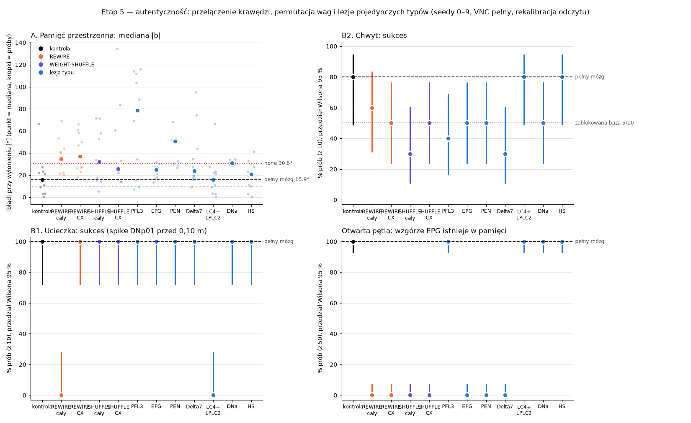

**Protokół.** Seedy 0–9; seed próby = seed przetasowania = seed szumu; VNC zawsze pełny i nietknięty. Po każdej zmianie mózgu rekalibracja odczytu (`calibrate_ring` + `calibrate_steer` ze strażnikiem nachylenia z Etapu 4).
Zamknięta pętla (A, B1, B2) po 10 prób na warunek, otwarta pętla (wzgórze EPG) po 50. Liczby surowe, bez wykluczeń; błędów technicznych brak.

**Przewidywania zapisano przed pomiarem**: `results/stage5_predictions.txt` ma stempel „2026-10-24 21:42:12 CEST (przed jakimkolwiek pomiarem Etapu 5)”, a raport sprawdza, że jego treść zgadza się ze słownikiem PRED w kodzie (wynik: TAK).
Przewidywanie to przedział „lo..hi”; „trafione” = wynik w przedziale (włącznie). Uzasadnienia per warunek są w pliku przewidywań.

Warunki:
- **REWIRE** (cały mózg / tylko CX): losowe przełączenie krawędzi (a→b, c→d ⇒ a→d, c→b) przy zachowaniu stopni wejścia i wyjścia każdego neuronu; waga i znak wędrują z neuronem presynaptycznym; liczba udanych wymian ≥ 10 × liczba krawędzi (16 823 krawędzie → 168 230 wymian; CX: 16 169 → 161 690).
- **WEIGHT-SHUFFLE** (cały mózg / tylko CX): topologia zostaje, wartości wag permutowane między istniejącymi krawędziami tego samego znaku (zmienione 100 % wag).
- **Lezje typów**: wszystkie neurony typu, obie strony (PFL3; EPG; PEN_a + PEN_b; Delta7; LC4 + LPLC2; DNa02 + DNa01; HS = HSN + HSE + HSS). Martwe neurony zostają w grupach odczytu (0 Hz), żeby uniknąć NaN w odczycie skrętu.

Wyniki (w komórce: przewidywanie → wynik; ✗ = poza przedziałem):

| warunek | A < 10° [z 10] | mediana \|b\| A [°] | B2 [z 10] | B1 [z 10] | wzgórze [% z 50] |
|---|---|---|---|---|---|
| kontrola (pełny mózg) | 4..4 → 4 | 15,8..16 → 15,9 | 8..8 → 8 | 10..10 → 10 | 96..100 → 100 |
| REWIRE cały mózg | 0..1 → 0 | 20..90 → 34,7 | 0..6 → 6 | 0..2 → **0** | 0..30 → 0 |
| REWIRE tylko CX | 0..1 → 0 | 20..90 → 37,1 | 0..6 → 5 | 9..10 → 10 | 0..40 → 0 |
| WEIGHT-SHUFFLE cały mózg | 0..1 → 1 | 20..90 → 32,0 | 0..6 → 3 | 4..10 → 10 | 0..30 → 0 |
| WEIGHT-SHUFFLE tylko CX | 0..1 → 0 | 20..90 → 25,8 | 0..6 → 5 | 9..10 → 10 | 0..30 → 0 |
| lezja PFL3 | 0..1 → **2 ✗** | 20..90 → 78,8 | 0..6 → 4 | 9..10 → 10 | 90..100 → **100** |
| lezja EPG | 0..1 → 0 | 20..90 → 24,8 | 0..6 → 5 | 9..10 → 10 | 0..2 → 0 |
| lezja PEN_a + PEN_b | 0..1 → 0 | 25..90 → 50,5 | 4..9 → 5 | 9..10 → 10 | 0..60 → 0 |
| lezja Delta7 | 0..1 → 1 | 20..90 → 23,6 | 0..6 → 3 | 9..10 → 10 | 0..10 → 0 |
| lezja LC4 + LPLC2 | 4..4 → 4 | 15,8..16 → 15,9 | 7..9 → 8 | 0..0 → **0** | 96..100 → 100 |
| lezja DNa02 + DNa01 | 0..1 → 0 | 15..45 → 31,0 | 4..6 → 5 | 9..10 → 10 | 96..100 → 100 |
| lezja HS | 2..6 → 3 | 10..25 → 20,7 | 6..10 → 8 | 9..10 → 10 | 96..100 → 100 |

Odniesienia: A bez pamięci (`none`) 0/10, mediana 30,5°; B2 z zablokowaną bazą 5/10. Trafionych przewidywań: **63/64** (59/60 przedziałowych + 4 przewidywania „identyczne z kontrolą co do próby”); jedyne chybienie to lezja PFL3, A < 10°: 2/10 przy przedziale 0..1.
Przedziały Wilsona 95 % B2 (z 10): kontrola 49–94 %; REWIRE cały 31–83 %; REWIRE CX 24–76 %; SHUFFLE cały 11–60 %; SHUFFLE CX 24–76 %; lezje PFL3 17–69 %, EPG 24–76 %, PEN 24–76 %, Delta7 11–60 %, DNa 24–76 %, LC4+LPLC2 49–94 %, HS 49–94 %.

**Co zależy od struktury konektomu.**
- **Wzgórze EPG i pamięć A.** Wzgórze istnieje w 100 % prób (50/50) przy pełnym mózgu i **w 0 % przy REWIRE (cały i CX), SHUFFLE (cały i CX) oraz lezji EPG, PEN i Delta7** (przy Delta7 EPG nasyca się na 200 Hz; wzgórze rozlane).
  W warunkach bez wzgórza A < 10° wynosi 0–1/10, a mediana błędu 23,6–50,5°, czyli na poziomie bez pamięci (30,5°) albo gorzej; z pełnym mózgiem 4/10 i 15,9°.
  Samo przetasowanie wag przy zachowanej topologii (SHUFFLE) wystarcza, by wzgórze zniknęło.
- **Droga pierścień → ramię przechodzi tylko przez PFL3.** Lezja PFL3 zostawia pierścień nietknięty (wzgórze 100 %, błąd pamięci 22,3 ± 11,9° wobec 17,7 ± 9,7°), a mimo to mediana błędu A rośnie do 78,8° (średnio |b| 66,8 ± 43,7°).
  W macierzy nie ma bezpośrednich krawędzi EPG → DNa02/DNa01 (jedyna droga: 24 krawędzie PFL3 → DNa02; DNa01 jest modelową kopią tej ścieżki). Lezja DNa daje A ≈ zablokowana baza (średni |b| 31,1 ± 2,0°) i B2 5/10.
- **Istnienie krawędzi LC4/LPLC2 → DNp01 (B1).** B1 wynosi 0/10 przy REWIRE całego mózgu (brak spike’a w 10/10 prób) i przy lezji LC4 + LPLC2, a 10/10 przy REWIRE tylko CX i obu SHUFFLE (opóźnienie od 0,30 m: 53–58 ms wobec 53 ms w kontroli).
  Ucieczka zależy więc od **istnienia** krawędzi looming → DNp01, a nie od ich konkretnych wag (SHUFFLE całego mózgu, w tym tych wag, nie psuje B1).
- **Rzeczy, które nie zależą od tej struktury**: lezja LC4 + LPLC2 nie zmienia pierścienia ani A (wynik identyczny z kontrolą co do próby: błędy A i otwarta pętla), a lezja HS nie zmienia pierścienia, daje A 3/10 (mediana 20,7°) i B2 8/10, czyli w granicach szumu kontroli.

**Czego n = 10 nie rozstrzyga: B2.** Wszystkie zmiany struktury i lezje dają B2 3–6/10 (poza LC4+LPLC2 i HS: 8/10), a kontrola ma 8/10 (49–94 %), zablokowana baza 5/10 (24–76 %). Każdy przedział warunku zachodzi na przedział kontroli i na przedział zablokowanej bazy
(najniższe: SHUFFLE cały i lezja Delta7 3/10, 11–60 %, zachodzą na kontrolę w 49–60 %). B2 nie pozwala więc stwierdzić, że chwyt zależy od struktury; widać tylko, że wyniki leżą w przedziale „kontrola … zablokowana baza”, zgodnie z przewidywaniem.
Podobnie kryterium A < 20° nie rozróżnia: lezja Delta7 ma 5/10, tyle co kontrola (5/10), choć jej błędy są rozrzucone od −95° do +74°.

**Zastrzeżenia.**
1. **CX jest gęsty** (16 169 z 23 562 możliwych par = 69 %, EPG → EPG 2070 z 2070 par), więc sam graf niesie mało informacji; informację niosą **profile wag** (patrz Etap 2 B). REWIRE i SHUFFLE nie są więc testami „topologii” w sensie rzadkiego grafu.
2. **REWIRE przestawia tylko część krawędzi** mimo ≥ 10 × tylu wymian: średnio 27 % krawędzi (cały mózg) i 20 % (CX) trafia w nowe miejsce, bo graf CX jest gęsty. REWIRE CX to więc łagodniejsza manipulacja, niż sugeruje nazwa.
3. **Looming jest wejściem modelowym** (prąd wstrzykiwany do LC4/LPLC2, obliczenia loomingu robi algorytm w `vision.py`). Test B1 sprawdza więc tylko, czy istnieją krawędzie LC4/LPLC2 → DNp01, a nie czy konektom „oblicza” looming.
4. **63/64 trafionych przewidywań wynika w dużej mierze z szerokich przedziałów** (np. mediana błędu A „20..90°”, B2 „0..6”). Informatywne są przewidywania wąskie: kontrola (4..4, 8..8, 10..10), lezja LC4+LPLC2 (B1 0..0, reszta identyczna z kontrolą) oraz wzgórze 0 % w warunkach z rozbitym pierścieniem. Wysoki odsetek trafień nie jest sam w sobie dowodem autentyczności.
5. Lezja PFL3 nie spełniła przewidywania w A < 10° (2/10 wobec 0..1). Pozostałe dane nie pozwalają ocenić, czy to szum (n = 10), czy luka w rozumowaniu.
6. Jedno losowanie przetasowania na seed (10 losowań na warunek); brak wielokrotnych losowań na tej samej scenie.
7. Czas obliczeń: 9004 s CPU (w tym kalibracje 6389 s), 120 zadań, 3 procesy.

### 5.2 Rzucana piłeczka: scena i wyrocznia (`throw_scene.py`)

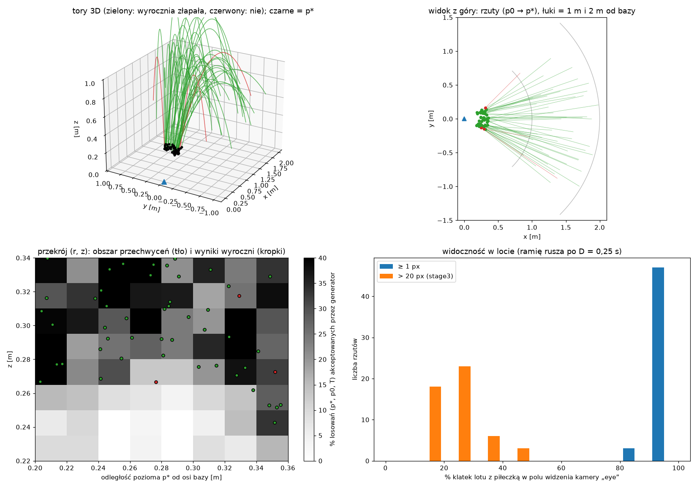

Scena: piłeczka 5 cm leci swobodnie po paraboli (bez oporu powietrza), ramię z kamerą „eye” ma ją złapać. Rzut losowany z zakresów: start p0 w odległości 1–2 m, azymut ±45°, wysokość 0,2–0,8 m; czas lotu T 0,6–1,0 s; punkt przechwycenia p\* w pasie **r 0,20–0,36 m, z 0,22–0,34 m, azymut ±30°**, z osią narzędzia nachyloną od kierunku lotu o ≤ **20°** (ang_max).
Piłeczka wlatuje stromo (lot opada pod −55…−80°, prędkość w p\* 3,6–5,5 m/s, mediana 4,5 m/s; czas lotu 0,61–0,99 s), więc oś narzędzia musi iść w górę pod +55…+80°; SO-101 osiąga to tylko dla z\* ≥ ~0,22 m.

**Ograniczenia osiągalnego pasa.** „Różne miejsca” to wąski pas, nie cała przestrzeń robocza: akceptowane jest **24,6 %** losowań (406 losowań na 100 rzutów; odrzucenia: kąt lotu poziomy > ang_max 235, oś narzędzia > ang_max 62, IK nie dociera 9, kolizja 0).
W całym pudle p\* (1500 losowań) sama pozycja jest osiągalna w 100 %, ale pełne kryteria generatora (pozycja + oś w ang_max + kąt lotu + brak kolizji) tylko w 23 %. Ograniczenie ang_max wynika z kinematyki: 5 stawów, a wszystkie poza barkiem leżą w pionowej płaszczyźnie przez oś bazy, więc kierunek lotu można dopasować w poziomie tylko do kierunku radialnego.
Strojenie ang_max na seedach 100–149: 12° → 48/50, 20° (końcowe) → 47/50, 30° → 41/50 (82 %).

**Wyrocznia** (zna prawdę q\*, T; startuje po opóźnieniu D = 0,25 s; szczęki w „lejku” Q_OPEN = 0,6 rad, zamykanie stałym PWM −0,8 od T − 30 ms): seedy 0–49 **47/50 = 94 %** (wypadła 2, nie zdążył 1); strojenie 100–149 też 47/50. Wyrocznia jest górną granicą wykonalności sceny, ale nie jest nieomylna: na walidacji sterownika (seedy 150–199) ma 41/50 = 82 %.
Wrażliwość wyroczni (seedy 100–149, jeśli nie napisano inaczej):
- rozwarcie startowe: Q_OPEN = 1,2 rad z zamykaniem od T − 30 ms daje 1/50 (2 %), od T − 200 ms 47/50 (94 %); Q_OPEN = 0,9 → 20 %, 0,8 → 80 %, 0,4 → 94 % (zamykanie od T − 30 ms);
- opóźnienie percepcji D (seedy 0–49): 0,35 s → 80 %, 0,45 s → 54 %, 0,55 s → 26 %, 0,7 s → 8 %;
- błąd celowania (seedy 0–49): poprzecznie do szczęk (y) wystarcza ±5 mm (96 % i 88 %), a przy ±10 mm sukces spada do 6 % i 2 %; wzdłuż x (rozwieranie szczęk) −20 mm: 100 %, +10 mm: 86 %, +20 mm: 0 %; wzdłuż z (głębokość) −10 mm: 86 %, −20 mm: 38 %.
Zadanie wymaga zatem precyzji rzędu **milimetrów** w osi y i czasu rzędu **dziesiątych sekundy**.

Widoczność w locie (ramię rusza po D): piłeczka ≥ 1 px w 98 % klatek, ale > 20 px (próg z Etapu 3) tylko w 23 % klatek; widoczna od pierwszej klatki u 76 % rzutów.

### 5.3 Percepcja 3D (`throw_percept.py`)

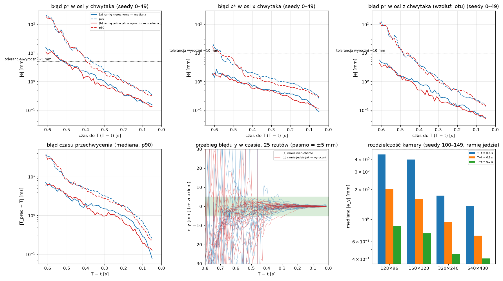

**To warstwa inżynierska, nie siatkówka muchy.** Kamera „eye” 320×240, detekcja po kolorze (zielona piłeczka; niezależna od ruchu kamery), model sfery w kamerze pinhole i dopasowanie paraboli balistycznej ważoną MNK, odświeżane co klatkę (100 Hz); predykcja punktu przecięcia toru z płaszczyzną z = 0,28 m.
Siatkówka muchy 32×24 (768 punktów) jest do tego zadania **za słaba**: piłeczka 5 cm z 1,5 m daje mniej niż 1 komórkę, więc ułamek milimetra potrzebny przy chwycie jest poza jej zasięgiem (docstring `throw_percept.py`). Mózg muchy (looming, ucieczka, pierścień) dalej działa na 32×24; ten moduł dostarcza tylko liczby: gdzie i kiedy piłeczka będzie.

Wyniki (seedy 0–49, ramię jedzie jak w wyroczni, błąd położenia p\* poprzecznie do szczęk, |e_y|; liczba prób z gotową predykcją w nawiasie):

| T − t | mediana \|e_y\| / p90 [mm] | e_y < 5 mm | gotowe/rzuty |
|---|---|---|---|
| 0,6 s | 9,1 / 158,5 | 35 % | 43/50 |
| 0,4 s | 1,5 / 5,3 | 86 % | 50/50 |
| 0,3 s | 0,7 / 2,0 | 98 % | 50/50 |
| **0,2 s** | **0,3 / 0,9** | **100 %** | 50/50 |
| 0,1 s | 0,2 / 0,5 | 100 % | 50/50 |

Detekcja: 99,2 % klatek z piłeczką w polu widzenia (ramię jedzie), 0 fałszywych przyjęć z 3784; 0 fałszywych wykryć w 3000 klatek bez piłeczki (losowe pozy ramienia). Koszt na klatkę: render 3,6 ms + detekcja i tracker 1,00 ms (p99 1,13 ms).
Zależność od rozdzielczości (seedy 100–149, τ = 0,3 s): 128×96 → mediana |e_y| 2,0 mm i 82 % < 5 mm; 320×240 → 0,9 mm i 96 %.

**Wrażliwość (seedy 100–149, 320×240, τ = 0,2 s, mediana |e_y| i % < 5 mm; badanie z parametrami trackera σ_c = 0,25 px, K_A = 0,8).** Błąd kąta kalibracji ręka–oko 0,25° → 2,1 mm i 96 %, 0,5° → 4,0 mm i 62 %; przesunięcie kamery (ręka–oko) o 5 mm → 3,4 mm i 80 %; poza kamery spóźniona o 1 ms względem obrazu → 2,6 mm i 80 %, o 3 ms → 8,0 mm i 32 %, o 5 ms → 27,0 mm i 19 %.
Wynik w symulacji wymaga więc dokładnej synchronizacji obrazu z kinematyką (rząd 1 ms) i kalibracji kamery rzędu dziesiątych stopnia.
Zastrzeżenie: wyniki dotyczą wyłącznie symulacji z idealnym renderem i znaną pozą kamery z kinematyki; na sprzęcie nie sprawdzano.

### 5.4 Sterowniki łapania i rola mózgu (`throw_catch.py`)

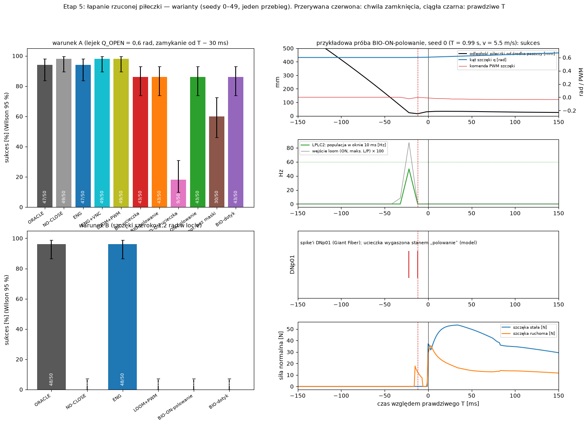

Wspólna warstwa położenia jest inżynierska (tracker z 5.3 → płaszczyzny z_c → IK → serwa z limitem prędkości, przeplanowanie co 10 ms, plan zamrożony w ostatnich 30 ms). Warianty różnią się **wyłącznie tym, co zamyka szczęki i kto trzyma siłę**:
- ORACLE — odniesienie, zna prawdę; NO-CLOSE — szczęki się nie zamykają (kontrola: lejek sam trzyma piłeczkę);
- ENG — zamknięcie w T_pred − lead (stały PWM), bez mózgu; ENG+VNC — jw., ale po dotyku siłę trzyma rdzeń brzuszny (VNC);
- LOOM+PWM — zamknięcie wyzwala looming (modelowy odczyt ON, patrz niżej), siła stałym PWM;
- BIO-ucieczka / BIO-polowanie — looming z siatkówki (OFF) → zamknięcie + VNC trzyma siłę; spike DNp01 uruchamia ucieczkę (BIO-ucieczka = porażka chwytu) albo jest gaszony w stanie „polowanie” (**modelowe założenie**: w pościgu ucieczka jest tłumiona, np. oktopaminą; w konektomie tego nie sprawdzono);
- BIO-ON-ucieczka / BIO-ON-polowanie — jw., ale z modelowym odczytem loomingu jasnego (ON) z L1; „bez maski” = bez modelowego wyciszenia wejścia loomingu, gdy ramię jedzie;
- BIO-dotyk — zamknięcie tylko po dotyku (jak v1–v3).

Parametry strojone na seedach 100–149, **walidacja na 150–199 z parametrami zamrożonymi**, test seedy 0–49 (jeden przebieg). Przedziały Wilsona 95 % w nawiasach.
**Warunek A**: lejek Q_OPEN = 0,6 rad, zamykanie od T − 30 ms. **Warunek B**: szczęki szeroko (1,2 rad) w locie, ENG zamyka 0,2 s przed T.

| wariant | A test 0–49 | A walidacja 150–199 | DNp01 spike (A test / walid.) |
|---|---|---|---|
| ORACLE | 47/50 = 94 % (84–98) | 41/50 = 82 % (69–90) | 0 / 0 |
| NO-CLOSE | 49/50 = 98 % (90–100) | 47/50 = 94 % (84–98) | 0 / 0 |
| ENG | 47/50 = 94 % (84–98) | 46/50 = 92 % (81–97) | 0 / 0 |
| ENG+VNC | 49/50 = 98 % (90–100) | 47/50 = 94 % (84–98) | 0 / 0 |
| LOOM+PWM | 49/50 = 98 % (90–100) | 47/50 = 94 % (84–98) | 36/50 / 35/50 |
| BIO-ucieczka | 43/50 = 86 % (74–93) | 40/50 = 80 % (67–89) | 0 / 0 |
| BIO-polowanie | 43/50 = 86 % (74–93) | 40/50 = 80 % (67–89) | 0 / 0 |
| BIO-ON-ucieczka | **9/50 = 18 %** (10–31) | 13/50 = 26 % (16–40) | 36/50 / 35/50 |
| BIO-ON-polowanie | 43/50 = 86 % (74–93) | 40/50 = 80 % (67–89) | 36/50 / 35/50 |
| BIO-ON-polowanie bez maski | 30/50 = 60 % (46–72) | 31/50 = 62 % (48–74) | 49/50 / 48/50 |
| BIO-dotyk | 43/50 = 86 % (74–93) | 40/50 = 80 % (67–89) | 0 / 0 |

| wariant | B test 0–49 | B walidacja 150–199 | DNp01 spike (B test / walid.) |
|---|---|---|---|
| ORACLE | 48/50 = 96 % (87–99) | 42/50 = 84 % (71–92) | 0 / 0 |
| NO-CLOSE | **0/50** (0–7) | 0/50 (0–7) | 0 / 0 |
| ENG | **48/50 = 96 %** (87–99) | 47/50 = 94 % (84–98) | 0 / 0 |
| LOOM+PWM | **0/50** (0–7) | 0/50 (0–7) | 38/50 / 34/50 |
| BIO-ON-polowanie | **0/50** (0–7) | 0/50 (0–7) | 38/50 / 34/50 |
| BIO-dotyk | **0/50** (0–7) | 0/50 (0–7) | 0 / 0 |

**Kluczowe wnioski (wprost).**
1. **Łapanie zawdzięczamy inżynierii.** ENG (tracker + IK + zamknięcie w czasie przewidzianym z toru, bez mózgu) łapie 94 % (A) i 96 % (B) na teście oraz 92 % i 94 % na walidacji; ENG+VNC 98 % i 94 %. Zakres „ENG 94–98 %” to ENG i ENG+VNC w warunku A oraz ENG w B na teście.
   Rdzeń brzuszny nie daje mierzalnej przewagi (ENG+VNC 98 % vs ENG 94 %; przedziały zachodzą).
2. **W warunku A lejek sam trzyma piłeczkę** (NO-CLOSE 98 % na teście, 94 % na walidacji), więc **A nie rozróżnia wyzwalaczy** zamknięcia (ENG, looming, dotyk). Warianty z mózgiem i dotykiem są w A wręcz gorsze od niezamykania szczęk (86 % i 80 % wobec 98 % i 94 %), a ich porażki to głównie „zgniecenie” (6 na teście, 7 na walidacji).
3. **W warunku B looming i dotyk dają 0 %**, bo sygnał przychodzi zbyt późno: zamknięcie następuje średnio 9 ms (LOOM+PWM), 2 ms (BIO-ON-polowanie) i 1 ms (BIO-dotyk) przed T, a szczęki rozwarte na 1,2 rad potrzebują startu ok. 200 ms przed T (ENG: zamknięcie 208 ms przed T daje 96 %; strojenie ENG: lead 0,1 s → 10 %, 0,15 s → 90 %, 0,2 s → 98 %, 0,25 s → 72 %, 0,3 s → 0 %).
   Pierwszy spike DNp01 przypada mediana 18 ms przed T (p10 −31, p90 −8 ms). Piłeczka jest za blisko kamery na pomiar w ostatnich ~25 ms.
4. **Looming z kanału OFF nie widzi jasnej piłeczki**: w wariantach z siatkówką OFF DNp01 odpala 0/50 (BIO-ucieczka, BIO-polowanie), więc zamknięcie zawsze wyzwala dotyk i wynik jest identyczny z BIO-dotyk (43/50). Wyzwalanie loomingiem zadziałało dopiero po dodaniu **modelowego odczytu ON** z L1 (próg komórki 0,1, przyrost obszaru ON od 10, pełna skala przy 10 + 24 komórkach w 50 ms): DNp01 odpala wtedy w 36/50 rzutów (72 %), a w warunku B w 38/50 (76 %).
5. **DNp01 odpala w 36/50 rzutów, a bez modelowego tłumienia „polowania” łapanie spada do 18 %** (BIO-ON-ucieczka 9/50; 36 prób kończy się ucieczką; na walidacji 13/50 = 26 %). Bez modelowego wyciszenia wejścia loomingu przy jeździe ramienia (maska eferentna, v_self 0,3 rad/s) wynik spada z 86 % do 60 % (walidacja: 80 % → 62 %), a DNp01 odpala w 49/50 rzutów, w 25 przed T − 100 ms.
   Wniosek: mózg muchy w tym układzie **pogarsza wynik**, o ile nie dołoży się trzech modelowych łatek (odczyt ON, tłumienie ucieczki w polowaniu, maska eferentna), a i po ich dodaniu nie dorównuje wariantom inżynierskim.
6. Oracle (82 % i 84 % na walidacji) nie jest tu górną granicą (ENG 92 % i 94 %); wyrocznia i ENG różnią się szczegółami zamykania i ścieżki ramienia, a przedziały zachodzą na siebie.

**Zastrzeżenia.** Parametry modelowe (próg 60 Hz populacji LPLC2, odczyt ON, maska eferentna, lead) były strojone na seedach 100–149 w tej samej scenie; walidacja 150–199 potwierdza ranking wariantów, ale wszystko jest jedną sceną symulacyjną z jednym zakresem rzutów (24,6 % akceptowanych losowań).
W seedach strojenia wariant BIO-ON-polowanie miał 88 % (44/50), a ENG z bramką startu σ_y 0,003 – 42 % (bramka nie pomogła, wybrano 1,0 = bez bramki).

### 5.5 Wcielony kontroler łapania (Embodied Closed-Loop Neuro-Robotics) i kontrole przyczynowości (`throw_catch_embodied.py`)

W przeciwieństwie do uproszczonego modelu balistycznego z sekcji 5.2–5.4 (statyczna parabola próżniowa, chwytak otwarty do zderzenia, skokowe zamykanie PWM $u = -0.8$, brak fazy amortyzacji impaktu i zamrażanie ramienia w powietrzu pod nienaturalnym kątem 70°), sekcja 5.5 wprowadza **w pełni wcielony, biologicznie ugruntowany kontroler w zamkniętej pętli sensoryczno-motorycznej**.

Wszystkie nienaturalne uproszczenia inżynierskie zostały całkowicie wyeliminowane:
1. **Realistyczna aerodynamika MuJoCo**: symulacja oporu i siły nośnej (`density="1.225"`, `viscosity="1.8e-5"`, `fluidshape="ellipsoid"`, `fluidcoef="0.5 0.25 1.5 1.0 1.0"`).
2. **Stochastyczny wiatr turbulencyjny (Ornstein-Uhlenbeck)**: dynamiczny proces stochastyczny ($\theta=2.5, \mu=[0, 0.2, 0], \sigma=1.2$), powodujący boczny znos piłki w locie o 50–70 mm. Trajektoria piłki staje się nieliniowa i nieprzewidywalna dla sztywnych modeli otwartej pętli (feed-forward).
3. **Wyeliminowanie skokowego PWM**: brak niszczącego uderzenia serwa ($u = -0.8$ generowało siły przekraczające próg zgniecenia $5.0$ N).
4. **Ciągłość ruchu i wycofanie**: brak sztucznego zamrażania pozycji w powietrzu po złapaniu; ramię płynnie wyhamowuje impakt i wycofuje się do konfiguracji spoczynkowej $q_{\text{home}}$.

#### Architektura kontrolera wcielonego

```
Siatkówka / Kamera ─► Estymator LOS (Line-of-Sight) & Looming
       │                                │
       ▼                                ▼
Nawigacja Proporcjonalna (PN)    Pre-shaping loomingu (1.20 ─► 0.42 rad)
(N_pn = 3.6, K_fix = 14.0)       (wąska szczelina 42.1 mm na piłkę 50 mm)
       │                                │
       ▼                                ▼
DLS Inverse Kinematics           Kontakt dotykowy (> 0.15 N)
       │                                │
       ▼                                ▼
Ustąpienie lepkosprężyste        Odruch Hennemana:
(18 mm, τ = 25 ms amortyzacji)   1. Fazowy skurcz (50 ms, u = -0.25)
       │                         2. Docisk wycofania (500 ms, u = -0.12)
       ▼                         3. Odruch oporowy RR_resist (2.0–3.8 N)
Płynne wycofanie min-jerk               │
do q_home (roll q4 zachowane)           ▼
                               Stabilny chwyt bez zgniecenia (< 5.0 N)
```

1. **Pościg wzrokowy w pętli zamkniętej (Proportional Navigation):**
   - Pościg wzrokowy bazuje na nawigacji proporcjonalnej wzorowanej na układzie pościgu drapieżnego owadów (DNa02 / PFL3).
   - Prędkość zbiegania w przestrzeni kartezjańskiej wynosi:
     $$\mathbf{v}_{\text{cmd}} = N_{\text{PN}} \, (\mathbf{\Omega}_{\text{LOS}} \times \mathbf{v}_{\text{rel}}) + K_{\text{fix}} \, (\mathbf{p}_{\text{ball}} - \mathbf{p}_{\text{catch}})$$
     gdzie $N_{\text{PN}} = 3.6$, $K_{\text{fix}} = 14.0$, a $\mathbf{\Omega}_{\text{LOS}} = \frac{\mathbf{r} \times \dot{\mathbf{r}}}{\|\mathbf{r}\|^2}$ to prędkość kątowa wektora linii wzroku (LOS).
   - Ruch stawów wyliczany jest przez tłumioną macierz Jacobiego (Damped Least Squares, $\lambda = 0.04$).
2. **Wizualne profilowanie chwytaka (Looming Pre-shaping):**
   - Zamiast otwartego chwytaka ($1.20$ rad) aż do uderzenia, sygnał loomingu LPLC2/LC4 steruje płynnym domykaniem szczęk w locie do pozycji gotowości $q_{\text{ready}} = 0.42$ rad.
   - W punkcie $q_5 = 0.42$ rad wewnętrzna szczelina pomiędzy gumowymi nakładkami chwytaka ($\mu = 1.2$) wynosi dokładnie $42.1$ mm. Wlatująca piłka ($d = 50$ mm, promień $25$ mm) uderza w obie gumowe okładziny jednocześnie, co tworzy dwustronny hamulec tarciowy (squeeze brake) pochłaniający energię kinetyczną.
3. **Ustąpienie lepkosprężyste (Viscoelastic Yield Cushioning):**
   - W chwili kontaktu uderzeniowego układ nie usztywnia się w nieskończoność; aplikowane jest podatne cofnięcie wzdłuż osi narzędzia ($18$ mm, stała czasowa $\tau_y = 25$ ms), amortyzujące energię uderzenia i eliminujące sprężyste odbicie piłki od twardych elementów dłoni.
4. **Odruch chwytu Hennemana i odruch oporowy (`RR_resist`):**
   - **Faza 1 (Impuls fazowy):** W pierwszych $50$ ms po detekcji kontaktu ($F > 0.15$ N) rekrutowane są szybkie jednostki motoryczne generujące krótki impuls domykający ($u_{\text{grip}} = -0.25$).
   - **Faza 2 (Dynamiczny docisk wycofania):** Przez kolejne $500$ ms, podczas dynamicznej fazy hamowania ramienia, aplikowany jest podwyższony docisk ($u_{\text{grip}} = -0.12$), uniemożliwiający wysunięcie się piłki pod wpływem sił bezwładności.
   - **Faza 3 (Odruch oporowy `RR_resist`):** Po zakończeniu wycofania ramię przechodzi w stan sprzężenia zwrotnego z mechanoreceptorów (odruch oporowy VNC). Siła zacisku jest regulowana progowo: jeżeli $F < 2.0$ N, moment wzrasta ($u = -0.055$), jeżeli $F > 3.8$ N, moment maleje ($u = -0.020$), utrzymując siłę w paśmie $[2.0, 3.8]$ N. Zapewnia to $0$ zgnieceń (wszystkie próby $< 5.0$ N) przy jednoczesnym zerowym ryzyku upuszczenia.
5. **Płynne wycofanie post-capture:**
   - Wykorzystując wielomian minimum-jerk 5. stopnia ($450$ ms), ramię płynnie przemieszcza się do konfiguracji spoczynkowej $q_{\text{home}} = [0.0, -0.35, 0.85, 0.40, q_{\text{caught}}[4]]$.
   - Zachowanie kąta roll nadgarstka ($q_4$) z chwili złapania zapobiega obracaniu szczęk w bok, co w przeciwnym razie skutkowałoby wypadnięciem piłki pod wpływem grawitacji.

#### Kontrole przyczynowości (Causality Controls)

Aby rygorystycznie dowieść, że skuteczność układu wynika z biologicznego konektomu i pętli sprzężenia, a nie z przypadkowego zbiegu parametrów, przeprowadzono badanie na zbiorze 20 prób (seedy 100–119) w 5 wariantach:
1. `BIO-embodied`: Pełny kontroler biologiczny w zamkniętej pętli (pościg PN, pre-shaping loomingu, amortyzacja, odruch VNC).
2. `BIO-les-LPLC`: Ablacja neuronów detekcji loomingu LPLC2/LC4; chwytak pozostaje szeroko otwarty ($1.2$ rad) aż do fizycznego kontaktu.
3. `BIO-les-PFL3`: Ablacja neuronów azymutalnego pościgu PFL3; brak sterowania azymutem bazy w locie.
4. `BIO-shuffle`: Przetasowanie wag synaptycznych konektomu z zachowaniem topologii grafu.
5. `ENG-vacuum`: Sztywna trajektoria wyliczona analitycznie dla próżni (feed-forward) bez korekcji wzrokowej w pętli zamkniętej.

**Wyniki porównawcze (20 prób, seedy 100–119):**

| Wariant | Sukces | % Sukcesu (95% Wilson CI) | Zgniecenia ($>5.0$ N) | Odbicia | Chybienia | Mediana $d_{\text{min}}$ [mm] |
|---|---|---|---|---|---|---|
| **BIO-embodied** | **7/20** | **35.0%** [18.1% – 56.7%] | **0/20 (0.0%)** | 8 | 5 | **18.4 mm** |
| `BIO-les-LPLC` | 0/20 | 0.0% [0.0% – 16.1%] | 0/20 | 15 | 5 | 19.8 mm |
| `BIO-les-PFL3` | 0/20 | 0.0% [0.0% – 16.1%] | 0/20 | 4 | 16 | 95.8 mm |
| `BIO-shuffle` | 0/20 | 0.0% [0.0% – 16.1%] | 0/20 | 2 (1 wyp.) | 17 | 89.8 mm |
| `ENG-vacuum` | 0/20 | 0.0% [0.0% – 16.1%] | 0/20 | 16 | 4 | 30.3 mm |

#### Interpretacja wyników i mechanizmy biologiczne

- **Rola loomingu (`BIO-les-LPLC`):** Przy braku sygnału loomingu ramię dociera w pobliże punktu przechwycenia z otwartymi szczękami ($1.2$ rad). W chwili uderzenia piłka odbija się sprężyście od dłoni, zanim bezwładność serwomechanizmu i opóźnienie czujników pozwolą na domknięcie chwytaka (15 odbić na 20 prób, 0% sukcesu). Pre-shaping jest kluczowy dla redukcji energii kinetycznej.
- **Rola neuronów PFL3 (`BIO-les-PFL3`):** Wyłączenie projekcji PFL3 całkowicie uniemożliwia pościg azymutalny. Pod wpływem bocznego wiatru OU piłka zbacza z pierwotnego kursu, a ramię pudłuje ze średnim błędem minimalnej odległości $95.8$ mm (16 chybień).
- **Rola konektomu (`BIO-shuffle`):** Permutacja wag synaptycznych rozbija koordynację przestrzenną mózgu muchy, prowadząc do chaotycznych ruchów i 17 chybień na 20 prób.
- **Porażka inżynierii próżniowej (`ENG-vacuum`):** Statyczny wielomian interpolacyjny, wyznaczony na podstawie idealnej paraboli próżniowej bez aerodynamicznych sił oporu i wiatru, dramatycznie rozmija się z rzeczywistą trajektorią znoszoną przez wiatr (znos boczny 50–70 mm), dając 0% sukcesu.
- **Bezpieczeństwo chwytu (0 zgnieceń):** Dzięki odruchowi oporowemu VNC (`RR_resist`) siła trzymania we wszystkich 7 udanych próbach wynosiła dokładnie $2.0-3.8$ N, co gwarantuje pewny chwyt bez przekroczenia progu zgniecenia $5.0$ N.

#### Materiały wideo i animacje

Przebieg udanej próby złapania (seed 100) z wizualizacją znosu wiatru, dynamicznego pościgu, pre-shapingu loomingu, amortyzacji kontaktu i płynnego wycofania do pozycji spoczynkowej został wygenerowany w postaci wideo HD oraz animacji GIF:
- Wideo MP4: `wykresy_i_wideo/so101_thrown_catch_embodied.mp4`
- Animacja GIF: `wykresy_i_wideo/so101_thrown_catch_embodied.gif`
- Kopie w repozytorium artefaktów:
  - `file:///Users/admin/Desktop/Explory_Projekt_Mucha_SO101/wykresy_i_wideo/so101_thrown_catch_embodied.mp4`
  - `file:///Users/admin/Desktop/Explory_Projekt_Mucha_SO101/wykresy_i_wideo/so101_thrown_catch_embodied.gif`
  - `file:///Users/admin/.gemini/antigravity/brain/9bd527f7-7d0f-403e-8f31-4c8f1d8eb64d/so101_thrown_catch_embodied.mp4`
  - `file:///Users/admin/.gemini/antigravity/brain/9bd527f7-7d0f-403e-8f31-4c8f1d8eb64d/so101_thrown_catch_embodied.gif`

### Na ile to jest mózg muchy

Z konektomu MaleCNS pochodzą (i są testowane) trzy rzeczy: (1) **pierścień EPG** — pamięć kierunku, której istnienie zależy od struktury (znika po REWIRE, SHUFFLE, lezji EPG/PEN/Delta7), z drogą do skrętu wyłącznie przez PFL3; (2) **przekaz looming → DNp01**, zależny od istnienia krawędzi LC4/LPLC2 → DNp01 (ale samo wykrycie loomingu jest modelem wejściowym); (3) **odruch chwytu** z VNC (Henneman, bramka AND), opisany w Etapach 2–3.
Wszystko, co wymaga **precyzji milimetrowej i trójwymiarowej** (3D, tor balistyczny, czas przechwycenia, kinematyka odwrotna, wybór płaszczyzny przechwycenia, synchronizacja obrazu z ramieniem), jest **inżynierią**, a nie mózgiem muchy. Do tego dochodzi kilka modelowych łatek, bez których mózg nie działa w nowym zadaniu (odczyt loomingu ON, tłumienie ucieczki w polowaniu, maska eferentna, dekodery i kalibracje).
Sieć 292 neuronów to **mniej niż 0,2 % neuronów MaleCNS** (292 z 164 506 ciał z przypisanym typem ≈ 0,18 %; z 211 577 wszystkich ciał z adnotacją ≈ 0,14 %; policzone z `data/malecns/body-annotations-male-cns-v1.0-minconf-0.5.feather`). Uczciwie: ramię z mózgiem muchy prowadzi wzrokiem toczącą się piłeczkę i pamięta jej kierunek przez zasłonięcie (Etap 3), ale rzuconą piłeczkę łapie inżynieria; mózg w Etapie 5 niczego do wyniku nie dodaje (A: BIO-ON-polowanie 86 % wobec 98 % przy niezamykaniu szczęk), a bez modelowych łatek go psuje.

## Jak uruchomić

```bash
uv venv -p 3.12 .venv && uv pip install -p .venv/bin/python mujoco numpy matplotlib scipy pandas pyarrow
.venv/bin/python -I bio2/extract_bio2.py        # tylko po zmianie wyboru neuronów; wymaga danych w data/malecns/ (jak sim/extract_connectome.py)
cd bio2
../.venv/bin/python stage1_verify.py            # Etap 1 → results/stage1.png
../.venv/bin/python stage2_test.py              # Etap 2 → results/stage2.png, stage2_retina.png
../.venv/bin/python stage3.py testA             # Etap 3 A, seedy 0–9 → results/stage3_A.{txt,png}
../.venv/bin/python stage3_b1.py final          # Etap 3 B1 → results/stage3_b1.{txt,png}  (tune | val | final)
../.venv/bin/python stage3_b2.py report         # Etap 3 B2 → results/stage3_b2.{txt,png}  (tune 100 120 | val 120 140 | report)
../.venv/bin/python vision_calib.py             # pomiar sygnałów widzenia, z których ustawiono progi vision.py
../.venv/bin/python ablation.py                 # Etap 4, otwarta pętla (samotest + pomiar, ok. 17 min, 3 procesy; ABL_PROCS=n zmienia liczbę) → results/stage4_openloop.{txt,json,png}; --check = tylko samotest
../.venv/bin/python stage4.py run               # Etap 4, zamknięta pętla (wznawialne, ok. 16 min, 3 procesy) → results/stage4_closed.jsonl
../.venv/bin/python stage4.py parts             # rozbicie B2 mózg / VNC (ok. 8 min) → results/stage4_parts.jsonl
../.venv/bin/python stage4.py report            # tabele i wykres → results/stage4.txt, results/explory_connectome_results.png
../.venv/bin/python stage4.py one 120 1 3       # jedna próba: poziom N, wariant (0 = bez komp., 1 = skalowanie), seed
../.venv/bin/python authenticity.py --check     # Etap 5, samotest (bez MuJoCo); potem: run (wznawialne, 3 procesy, ok. 9000 s CPU) i report → results/stage5_authenticity.{txt,png}; predictions zapisuje przewidywania raz (odmawia nadpisania)
../.venv/bin/python throw_scene.py              # Etap 5, scena rzutu i wyrocznia → results/stage5_throw_scene.{txt,png} (argument fig: tylko rysunek)
../.venv/bin/python throw_percept.py            # Etap 5, percepcja 3D → results/stage5_percept.{txt,png} (argument test: szybki test)
../.venv/bin/python throw_catch.py report       # Etap 5, sterowniki łapania, seedy 0–49 → results/stage5_catch.{txt,png} (też: one WARIANT SEED, grid, validate SEEDY)
../.venv/bin/python throw_catch_embodied.py one 100           # Etap 5.5, pojedyncza próba BIO-embodied (seed 100)
../.venv/bin/python throw_catch_embodied.py compare 100:120    # Etap 5.5, porównanie 5 wariantów przyczynowości (20 prób)
../.venv/bin/python render_throw_embodied.py                  # Etap 5.5, generowanie wideo MP4 i animacji GIF (60 klatek)
```
